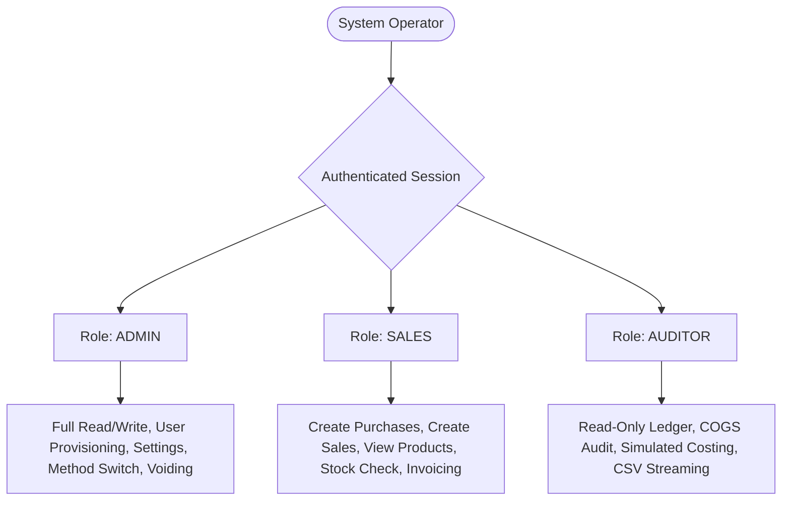
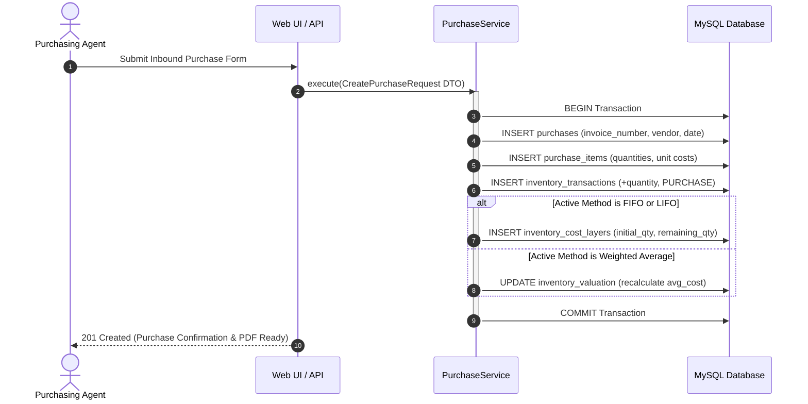
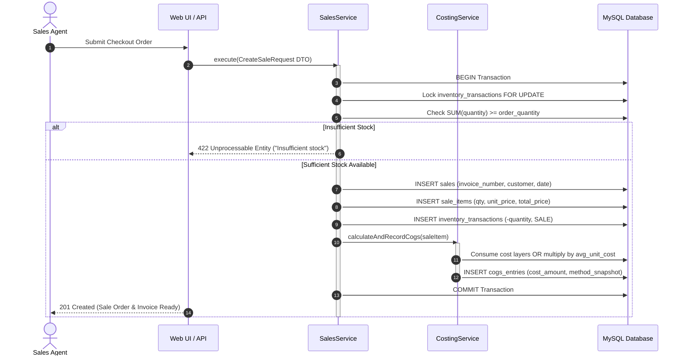
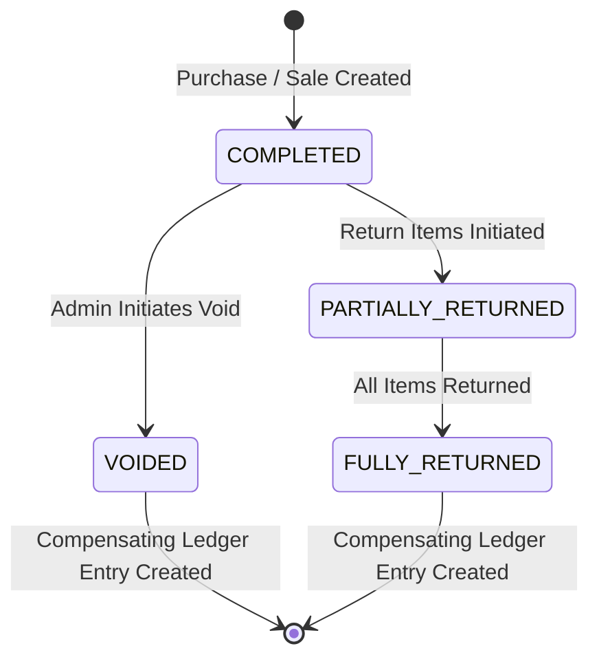

# 📋 System Functional Requirements Specification (FRS)

## 📌 Document Overview & Purpose

This document provides a comprehensive **Functional Requirements Specification (FRS)** for the **Stock & Financial Management System** (Aluminum Trading Inventory & Cost of Goods Sold Platform). It serves as the definitive reference for business analysts, software engineers, auditors, and system operators regarding what the platform must do, how it handles business transactions, its operational constraints, actor roles, and system workflows.

---

## 🏢 1. System Vision & Business Context

### 1.1 Business Profile
The platform is purpose-built for an **industrial aluminum trading enterprise**. The business model possesses the following structural attributes:
1. **Pure Trading Model (Wholesale / Distribution):** The company purchases finished aluminum profiles, sheets, and accessories from domestic and international mills and sells them directly to fabricators, contractors, and retail clients. The company **does NOT manufacture, smelt, or alter products**.
2. **Variant-Sensitive Inventory:** Aluminum items are governed by physical attributes where two physically similar items cannot be pooled together:
   - **Finish / Color:** e.g., Mill Finish, Anodized Silver, Matte Black, Bronze, White Powder Coated.
   - **Origin / Supply Stream:** e.g., `LOCAL` vs. `IMPORTED` (often carrying significant duty and cost differentials).
   - **Dimensions:** Thickness (gauge), profile length (e.g., 5.8m, 6.0m), and alloy grade.
3. **Multi-Warehouse Partitioning:** Goods reside in multiple physical locations (e.g., Central Warehouse, Harbor Yard, Retail Depot). Stock movements and costing must be tracked per warehouse.

### 1.2 Core Architectural Principles
* **Ledger-Based Truth:** Physical inventory is **never** stored as a static integer in the database. Stock is strictly derived dynamically from signed movements in an audit ledger:
  $$\text{Current Stock} = \sum (\text{inventory\_transactions.quantity})$$
* **Non-Destructive Accounting:** Financial records and stock movements are never deleted (`SQL DELETE` is prohibited on business records). Errors are resolved through compensating reversal transactions (`VOID`, `RETURN`).
* **Frozen Historical Costing:** Cost of Goods Sold (COGS) is calculated and snapshotted permanently into `cogs_entries` at the exact millisecond of checkout. Changes in future costs never alter past financial reports.

---

## 👥 2. Actors, Personas & Role-Based Access Control (RBAC)

The system enforces strict three-tier role-based authorization:

### 2.1 Roles & Permission Matrix

| Capability / Action | `ADMIN` | `SALES` | `AUDITOR` |
| :--- | :---: | :---: | :---: |
| **Authenticate / Password Reset** | ✅ | ✅ | ✅ |
| **View Dashboard Executive Metrics** | ✅ | ✅ | ✅ |
| **View Product Catalog & Live Stock** | ✅ | ✅ | ✅ |
| **Create / Edit Master Products & Variants** | ✅ | ❌ | ❌ |
| **Bulk Import Products via JSON** | ✅ | ❌ | ❌ |
| **Create Purchase Order (Inbound Goods)** | ✅ | ✅ | ❌ |
| **Create Sales Order (Outbound Fulfillment)** | ✅ | ✅ | ❌ |
| **Void Sales / Purchases** | ✅ | ❌ | ❌ |
| **Initiate Customer / Vendor Returns** | ✅ | ✅ | ❌ |
| **Switch System Costing Method (FIFO/LIFO/AVCO)** | ✅ | ❌ | ❌ |
| **Access COGS Audit Report & Simulation Switcher** | ✅ | ❌ | ✅ |
| **Export Financial Data to CSV** | ✅ | ❌ | ✅ |
| **Generate & Download Printable PDF Invoices** | ✅ | ✅ | ✅ |
| **Manage Users (Create, Edit Roles, Toggle Status)** | ✅ | ❌ | ❌ |

---

## ⚙️ 3. Detailed Functional Requirements by Subsystem

### 3.1 Subsystem 1: Product Catalog & Variant Management

#### FR-CAT-01: Hierarchical Product Definition
* **Requirement:** The system shall support a 2-tier catalog hierarchy:
  1. **Master Product:** Holds generic product attributes (e.g., Code `ALU-TUBE-50`, Name "Aluminum Rectangular Tube 50x25mm", Category "Profiles", Base Unit "PCS").
  2. **Product Variant:** Represents the exact sellable SKU specifying:
     - `sku`: Unique SKU string across the entire organization.
     - `variant_name`: Descriptive display name (e.g., "50x25mm - Matte Black - 1.2mm - Local").
     - `color`: Finish/anodizing specification.
     - `origin`: Origin classification (`LOCAL` or `IMPORTED`).
     - `barcode`: EAN/UPC identifier.
* **Business Rule:** Inventory movements, costing layers, and sales lines must **always** reference `variant_id`, never the master product.

#### FR-CAT-02: Bulk JSON Catalog Ingestion
* **Requirement:** The system shall provide an administrative endpoint and UI interface to bulk-ingest master products and nested variants from structured JSON payloads.
* **Validation Guards:**
  - Duplicate SKUs within the payload or existing database must be rejected with an atomic rollback.
  - Required fields (`code`, `name`, `unit`, `variants[].sku`, `variants[].origin`) must be validated before database insertion.

---

### 3.2 Subsystem 2: Multi-Warehouse Management & Stock Derivation

#### FR-WAR-01: Multi-Location Warehouse Partitioning
* **Requirement:** The system shall support multiple distinct physical warehouses (e.g., Main Yard, Secondary Depot).
* **Business Rule:** Each warehouse maintains independent stock levels and independent weighted average cost pools. A sale fulfilled from Warehouse A does not deduct stock or layers from Warehouse B.

#### FR-WAR-02: Ledger-Derived Live Stock Lookups
* **Requirement:** The system shall calculate available stock dynamically using the formula:
  $$\text{Stock}(v, w) = \sum_{t \in T_{(v,w)}} t.\text{quantity}$$
  where $t.\text{quantity} > 0$ for receipts/returns and $t.\text{quantity} < 0$ for shipments/outbounds.
* **Performance Requirement:** Queries must utilize composite indexes on `(variant_id, warehouse_id)` ensuring sub-10ms response times for stock checks.

---

### 3.3 Subsystem 3: Purchasing & Inbound Supply Chain

#### FR-PUR-01: Purchase Order Recording
* **Requirement:** The system shall record inbound shipments specifying `purchase_date`, `vendor_name`, `invoice_number`, `warehouse_id`, and line items containing `variant_id`, `quantity`, and `unit_cost`.
* **Database State Changes:**
  1. A master record is created in `purchases` with status `COMPLETED`.
  2. Individual rows are inserted into `purchase_items`.
  3. Positive inventory ledger records (`type = 'PURCHASE'`, `quantity = +Q`) are inserted into `inventory_transactions`.
  4. Cost layers are created in `inventory_cost_layers` (for FIFO/LIFO tracking).
  5. The weighted average pool in `inventory_valuation` is mathematically recalculated.

#### FR-PUR-02: Landed Cost & Currency Precision
* **Requirement:** Unit costs must support 4 decimal places of precision (`DECIMAL(15, 4)`) to accurately capture freight, customs duties, and bulk conversion rates. Line item totals and invoice grand totals must round to 2 decimal places (`DECIMAL(15, 2)`).

---

### 3.4 Subsystem 4: Sales & Outbound Fulfillment

#### FR-SAL-01: Pre-Checkout Stock Availability Guard
* **Requirement:** The system shall verify available stock for every line item prior to accepting an order.
* **Negative Stock Prevention:** The system **strictly forbids negative inventory**. If requested quantity exceeds available ledger stock, the entire transaction must abort with HTTP 422.
* **Concurrency Locking:** Inbound checks must acquire row-level locks (`FOR UPDATE`) within the database transaction to prevent race conditions when two operators sell the same inventory simultaneously.

#### FR-SAL-02: Outbound Ledger Realization & COGS Snapshot
* **Requirement:** Upon successful validation, the system shall:
  1. Insert an outbound transaction into `inventory_transactions` (`type = 'SALE'`, `quantity = -Q`).
  2. Invoke `CostingService` to calculate exact cost of goods sold according to the active company costing method.
  3. Permanently write the calculated cost to `cogs_entries` linked to `sale_item_id`.

#### FR-SAL-03: Professional PDF Invoice Generation
* **Requirement:** Every sale order must offer an immediate, client-side downloadable PDF tax invoice containing corporate header, customer billing information, line items (item name, SKU, quantity, unit price, line total), and grand total.

---

### 3.5 Subsystem 5: Costing Engine & Inventory Valuation

#### FR-CST-01: Triple-Method Support
* **Requirement:** The system must natively implement three internationally recognized inventory valuation methodologies:
  1. **FIFO (First-In, First-Out):** Oldest batches depleted first.
  2. **LIFO (Last-In, First-Out):** Newest batches depleted first.
  3. **Weighted Moving Average:** Continuous perpetual pooled average unit cost.

#### FR-CST-02: Active vs. Simulated Costing
* **Requirement:**
  - **Active Method:** Defines how real-time checkout transactions create permanent records in `cogs_entries`.
  - **Simulated Method:** The system must allow auditors to run financial reports simulating what historical COGS and Gross Profit would have been under alternative methods without modifying the actual ledger or recorded financials.

---

### 3.6 Subsystem 6: Audit Trail, Voiding & Reversals

#### FR-AUD-01: Prohibited Hard Deletions
* **Requirement:** Business entities (`purchases`, `purchase_items`, `sales`, `sale_items`, `inventory_transactions`, `cogs_entries`) must never be deleted via SQL `DELETE`.

#### FR-AUD-02: Non-Destructive Voiding Workflow
* **Requirement:** Authorized administrators may void a sale or purchase.
* **Operational Execution:**
  - The entity status transitions to `VOIDED`.
  - A compensating row is inserted into `inventory_transactions`:
    - Voiding a Sale ($Q_{\text{sold}}$) creates an entry with $+Q_{\text{sold}}$ (`type = 'SALE_RETURN'`).
    - Voiding a Purchase ($Q_{\text{bought}}$) creates an entry with $-Q_{\text{bought}}$ (`type = 'PURCHASE_RETURN'`).
  - For FIFO/LIFO, consumed layer quantities are restored; for Weighted Average, the moving pool is compensated.

#### FR-AUD-03: Partial Customer & Vendor Returns
* **Requirement:** The system shall allow returning individual quantities from an invoice. Returns must explicitly cite the parent invoice number, creating distinct return line items and signed compensatory ledger movements.

---

### 3.7 Subsystem 7: Executive Analytics & Financial Reporting

#### FR-REP-01: Corporate Fiscal Year Compliance
* **Requirement:** All annual calculations and quarterly analytics must adhere to the company's fiscal calendar running from **July 1 to June 30** (not calendar year January to December).

#### FR-REP-02: Real-Time Executive KPI Dashboard
* **Requirement:** The dashboard must calculate and display:
  1. **Gross Revenue:** $\sum \text{sale\_items.total\_price}$ for active (non-voided) sales.
  2. **Total Cost of Goods Sold (COGS):** $\sum \text{cogs\_entries.total\_cost}$ for active sales.
  3. **Gross Profit:** $\text{Gross Revenue} - \text{Total COGS}$.
  4. **Gross Margin Percentage:** $\frac{\text{Gross Profit}}{\text{Gross Revenue}} \times 100\%$.
  5. **Monthly Trajectory:** Visual SVG trend line displaying monthly Revenue vs. COGS across the 12 fiscal months.
  6. **Top Performing SKUs:** Ranked table of best-selling products by quantity, revenue, and gross profit contribution.

#### FR-REP-03: Asynchronous CSV Streaming
* **Requirement:** The system must export large valuation and COGS audit reports as streaming CSV downloads using chunked database cursors (`lazy()` in Laravel) to prevent PHP memory exhaustion.

---

## 🔒 4. Non-Functional Requirements (NFR)

### 4.1 Data Integrity & Concurrency
* **ACID Compliance:** All multi-step operations (e.g., Sale + Ledger Row + Layer Depletion + COGS Entry) must be wrapped inside atomic database transactions (`DB::transaction`).
* **Deadlock Avoidance:** Row updates on inventory cost layers must be sorted deterministically by primary key prior to locking.
* **Precision Standards:**
  - Quantities: `DECIMAL(15, 4)`
  - Unit Prices & Unit Costs: `DECIMAL(15, 4)`
  - Monetary Totals & Subtotals: `DECIMAL(15, 2)`

### 4.2 Performance & Scalability
* **Read Response Times:** Standard REST API endpoints must respond in $\le 200\text{ms}$.
* **Dashboard Caching:** Aggregated financial metrics for the current fiscal year must be cached in memory for **5 minutes** (`Cache::remember`), with instant invalidation upon new sales or purchases.
* **Client Caching:** Frontend dashboard components must implement a 5-minute in-memory cache to eliminate redundant network roundtrips during tab navigation.

### 4.3 Security & Audit Attribution
* **User Attribution:** Every row created in `purchases`, `sales`, `inventory_transactions`, and `returns` must record `created_by` storing the authenticated user's UUID.
* **Anti-Tampering:** Session tokens and CSRF verification (`X-XSRF-TOKEN`) are mandatory for all state-changing HTTP verbs (`POST`, `PUT`, `DELETE`).
* **Admin Safety Lockout:** The system must actively prevent an administrator from deleting their own account or demoting the last remaining active administrator.

---

## 📊 5. Summary Traceability Matrix

| Requirement Group | Primary Service | Primary Database Tables | Primary UI Screen |
| :--- | :--- | :--- | :--- |
| **Catalog & SKUs** | Eloquent / BulkImporter | `products`, `product_variants` | `/catalog` |
| **Warehouse Stock** | `InventoryService` | `warehouses`, `inventory_transactions` | `/warehouses`, Live Drawer |
| **Purchasing** | `PurchaseService` | `purchases`, `purchase_items`, `inventory_cost_layers` | `/purchases` |
| **Sales Fulfillment** | `SalesService` | `sales`, `sale_items`, `inventory_transactions` | `/sales` |
| **COGS & Costing** | `CostingService` | `cogs_entries`, `inventory_cost_layers`, `inventory_valuation` | `/cogs` |
| **Audit & Reversals**| `CorrectionService`| `inventory_transactions`, `cogs_entries` | Void/Return Modals |
| **Analytics & KPIs** | `FinancialReportService` | Dynamic query across sales & cogs | `/dashboard` |
| **User Administration**| Direct Auth Controller| `users` | `/users` |
