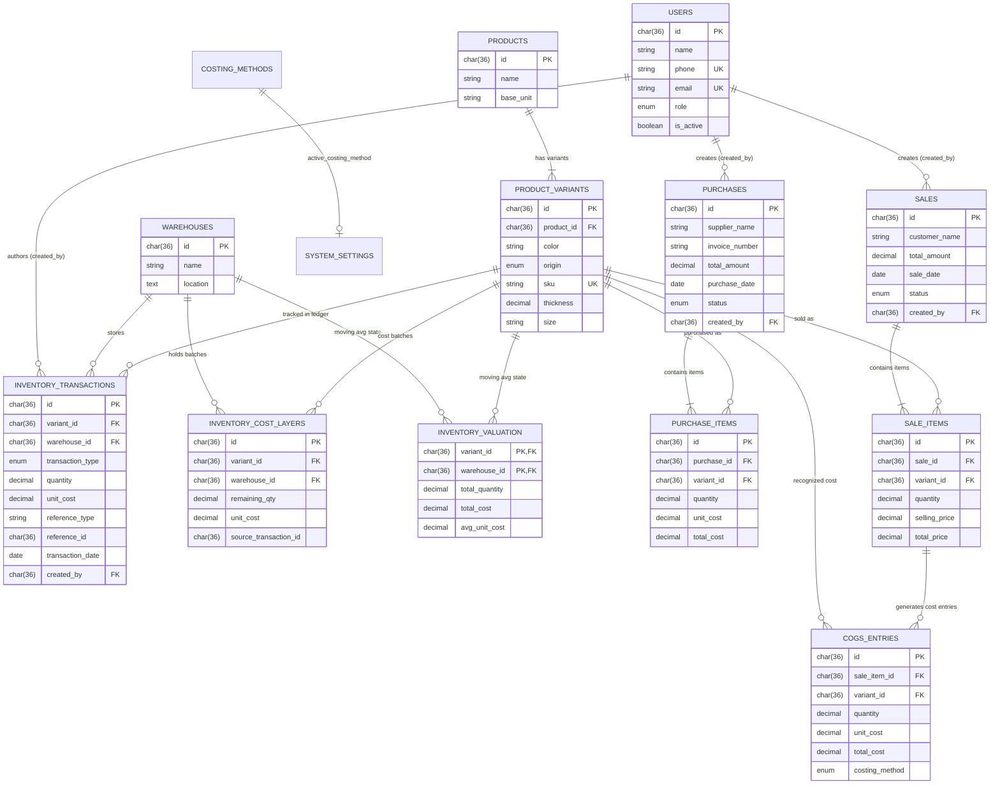
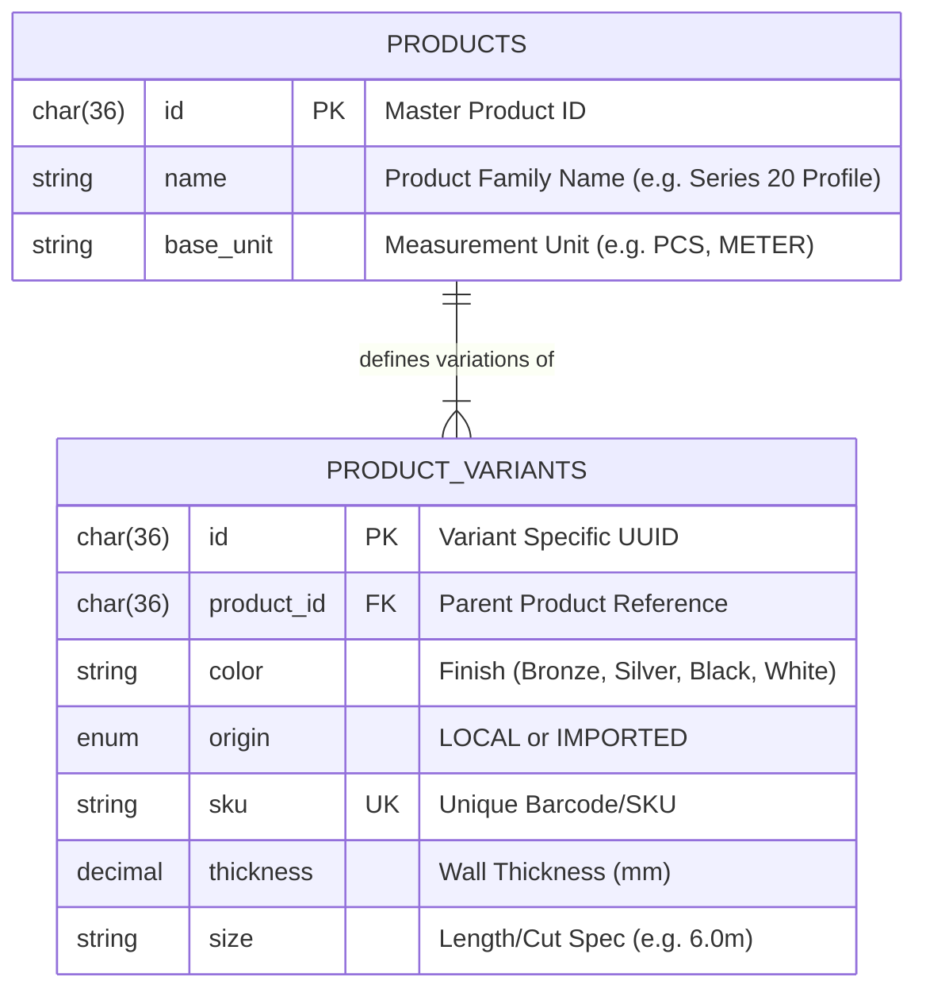
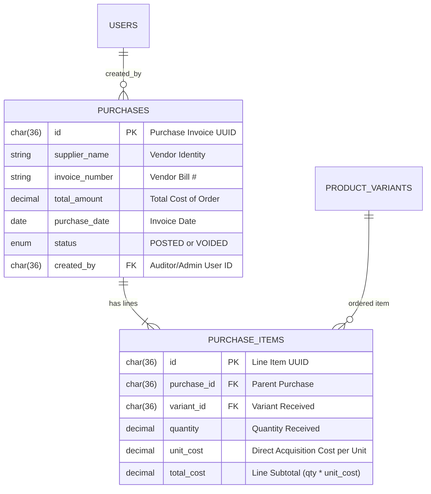
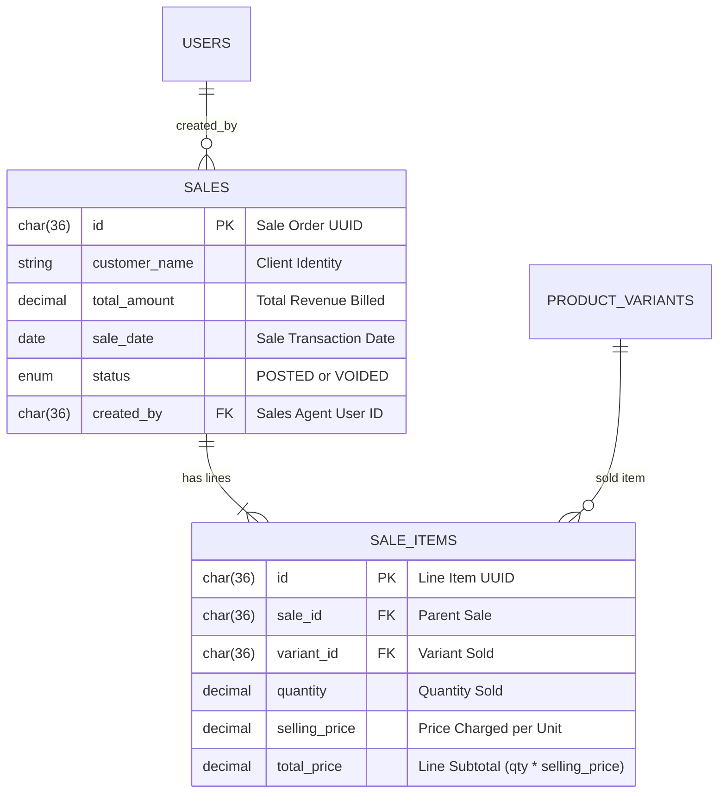
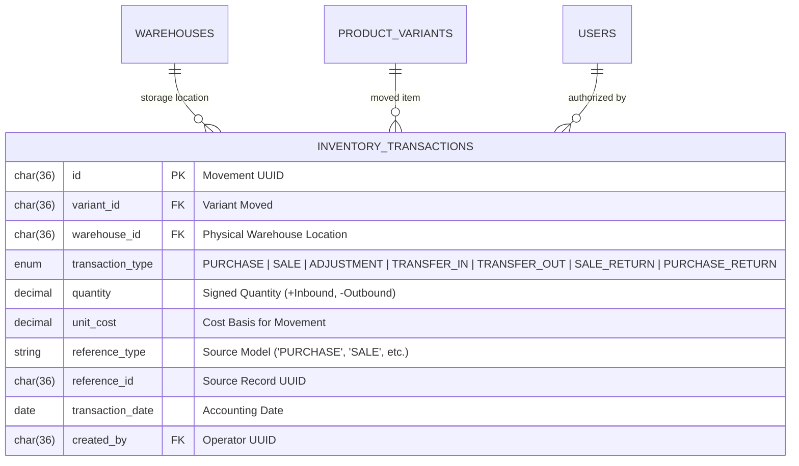
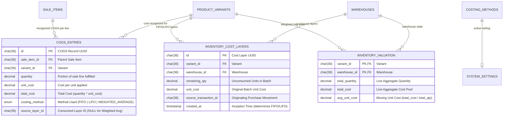

# 🗺️ Entity Relationship & Schema Diagrams

This document visualizes the entire relational database schema using Mermaid diagrams and provides a complete Foreign Key Cardinality Matrix.

---

## 🌐 Complete Global Entity Relationship Diagram (ERD)

The following diagram maps all primary operational tables, their primary keys, foreign keys, and cardinalities:

---

## 🔍 Subsystem Focused Diagrams

### 1. Catalog & Variant Subsystem

The business sells aluminum profiles in specific physical finishes, origins, and sizes.

---

### 2. Purchases & Inbound Invoicing Subsystem

Captures vendor shipments and lines.

---

### 3. Sales & Outbound Revenue Subsystem

Captures client orders and line items (the single source of Revenue).

---

### 4. Inventory Ledger & Multi-Warehouse Subsystem

The immutable movement ledger that derives stock quantities.

---

### 5. Costing Engines & COGS Subsystem

Handles the three financial costing methods (FIFO, LIFO, and Weighted Average).

---

## 📊 Foreign Key Cardinality & Integrity Matrix

| Parent Table | Parent Key | Child Table | Foreign Key | Cardinality | Business Meaning & Rules |
| :--- | :--- | :--- | :--- | :---: | :--- |
| `products` | `id` | `product_variants` | `product_id` | `1 : N` | A product can have multiple variants (colors, thicknesses). |
| `users` | `id` | `purchases` | `created_by` | `1 : N` | Every purchase records the operator who created it. |
| `purchases` | `id` | `purchase_items` | `purchase_id` | `1 : N` | A purchase order contains one or more line items. |
| `product_variants` | `id` | `purchase_items` | `variant_id` | `1 : N` | A purchase item specifies exactly one variant. |
| `users` | `id` | `sales` | `created_by` | `1 : N` | Every sale records the salesperson who generated it. |
| `sales` | `id` | `sale_items` | `sale_id` | `1 : N` | A sales invoice contains one or more line items. |
| `product_variants` | `id` | `sale_items` | `variant_id` | `1 : N` | A sale item specifies exactly one variant. |
| `product_variants` | `id` | `inventory_transactions` | `variant_id` | `1 : N` | Ledger tracks stock delta per variant. |
| `warehouses` | `id` | `inventory_transactions` | `warehouse_id` | `1 : N` | Ledger tracks stock delta per warehouse. |
| `users` | `id` | `inventory_transactions` | `created_by` | `1 : N` | Ledger records who authorized each stock move. |
| `product_variants` | `id` | `inventory_cost_layers` | `variant_id` | `1 : N` | FIFO/LIFO batches per variant. |
| `warehouses` | `id` | `inventory_cost_layers` | `warehouse_id` | `1 : N` | FIFO/LIFO batches are segregated by warehouse. |
| `product_variants` | `id` | `inventory_valuation` | `variant_id` | `1 : N` | Weighted Average composite primary key component. |
| `warehouses` | `id` | `inventory_valuation` | `warehouse_id` | `1 : N` | Weighted Average composite primary key component. |
| `sale_items` | `id` | `cogs_entries` | `sale_item_id` | `1 : N` | A sale item can consume multiple cost layers (e.g. 5 from layer A, 5 from layer B). |
| `product_variants` | `id` | `cogs_entries` | `variant_id` | `1 : N` | Cost snapshot records the affected variant. |
| `costing_methods` | `id` | `system_settings` | `active_costing_method` | `1 : 1` | System setting references the active costing engine. |
