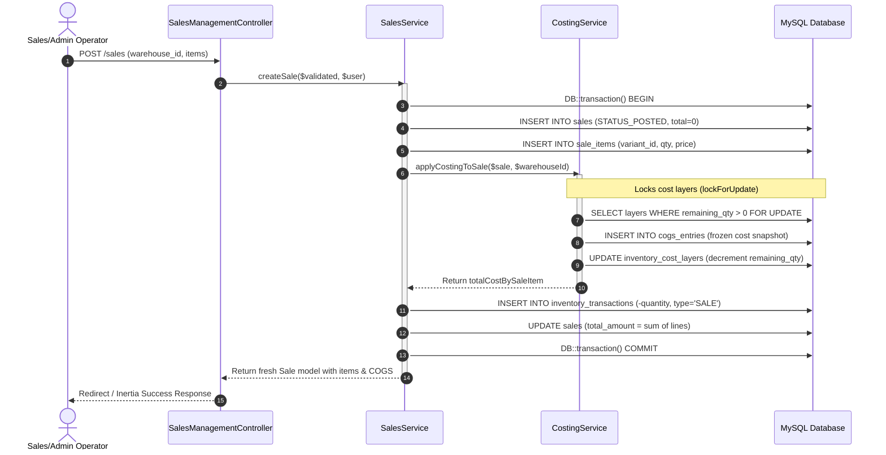
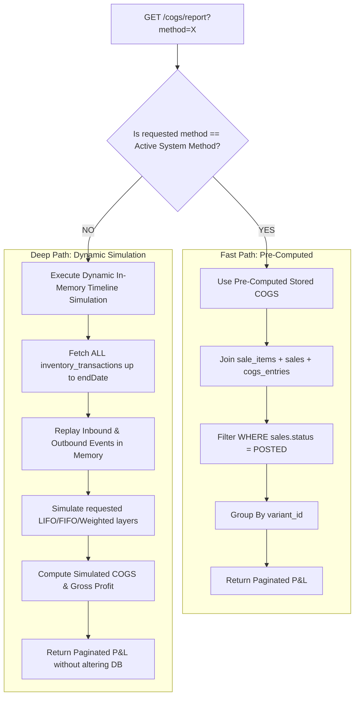

# ⚙️ Service Layer & Business Engines

## 📌 Architectural Overview

The backend architecture adheres to a strict **Service-Oriented Design Pattern**. Controllers in this system are deliberately thin HTTP adapters; they contain **zero financial algorithms, zero stock mutation logic, and zero multi-table orchestration**.

All domain rules, accounting ledgers, concurrency locks, and valuation calculations are encapsulated within **four specialized business services**:

```
+-----------------------------------------------------------------------------------+
|                                BACKEND SERVICE LAYER                              |
+-----------------------------------------------------------------------------------+
|  1. PurchaseService   --> Inbound purchasing, itemization, and vendor reception   |
|  2. SalesService      --> Outbound selling, line pricing, and customer billing    |
|  3. CostingService    --> FIFO, LIFO, Weighted Avg engines & COGS reporting       |
|  4. CorrectionService --> Safe voiding, partial returns, and non-destructive audits|
+-----------------------------------------------------------------------------------+
```

---

## 🏗️ Service Interaction Matrix



---

## 1. `App\Services\PurchaseService`

### Purpose & Responsibility
Orchestrates inbound vendor purchases. When aluminum goods arrive at a warehouse, `PurchaseService` guarantees that:
1. The purchase invoice header and items are persisted atomically.
2. An inbound movement (`+quantity`) is written to `inventory_transactions`.
3. The inventory costing engine is notified to create new cost layers or update moving average pools.

### Method Specifications

#### `createPurchase(array $validated, ?User $user): Purchase`
- **Database Transaction Scope:** Runs entirely inside `DB::transaction()`. If any item fails, all changes rollback.
- **Input Parameters:**
  - `$validated`: Associative array containing `supplier_name`, `invoice_number`, `purchase_date`, `warehouse_id`, `notes`, and an array of `items` (`variant_id`, `quantity`, `unit_cost`).
  - `$user`: Authenticated user entity (stored as `created_by`).
- **Execution Flow:**
  1. Creates `purchases` record with initial `status = POSTED` and `total_amount = 0`.
  2. Iterates over `$validated['items']`:
     - Calculates line total: `round($quantity * $unitCost, 2)`.
     - Creates child `purchase_items` record.
     - Creates `inventory_transactions` row with `transaction_type = 'PURCHASE'`, `quantity = +$quantity`, `unit_cost = $unitCost`, `reference_type = Purchase::class`, `reference_id = $purchase->id`.
     - Calls `CostingService::recordPurchase()` to instantiate cost layers or update valuation.
  3. Updates parent `purchases.total_amount` with the calculated sum.
  4. Returns the freshly reloaded `Purchase` model with eager-loaded `items`.

#### `updateMetadata(Purchase $purchase, array $validated): Purchase`
- **Financial Protection Rule:** Never alters `total_amount`, quantities, costs, or line items.
- **Allowed Attributes:** Only updates `supplier_name` and `notes`.

---

## 2. `App\Services\SalesService`

### Purpose & Responsibility
Orchestrates customer sales orders. It acts as the gatekeeper preventing negative inventory and writes permanent financial snapshots.

### Method Specifications

#### `createSale(array $validated, ?User $user): Sale`
- **Database Transaction Scope:** Runs within `DB::transaction()`.
- **Execution Flow:**
  1. Creates `sales` header with `status = POSTED` and `total_amount = 0`.
  2. Iterates over `$validated['items']` and inserts child `sale_items` rows (`quantity`, `selling_price`, `total_price`).
  3. Delegates to `CostingService::applyCostingToSale($sale, $warehouseId)`:
     - Verifies physical stock availability.
     - Depletes FIFO/LIFO layers or Weighted Average pools.
     - Writes permanent `cogs_entries` records.
     - Returns mapped unit and total costs per sale item.
  4. Inserts outbound `inventory_transactions` rows:
     - `transaction_type`: `'SALE'`
     - `quantity`: `-$quantity` (negative signed quantity)
     - `unit_cost`: Exact recognized COGS unit rate (`round($totalCost / $quantity, 4)`).
     - `reference_type`: `Sale::class`
     - `reference_id`: `$sale->id`
  5. Updates `sales.total_amount` with the final gross revenue.
  6. Returns fresh `Sale` model.

#### `updateMetadata(Sale $sale, array $validated): Sale`
- **Allowed Attributes:** Only updates `customer_name` and `notes`. Prevents tampering with billed quantities or prices.

---

## 3. `App\Services\CostingService`

### Purpose & Responsibility
The core mathematical engine of the system. Implements FIFO, LIFO, and Weighted Average costing, dynamic historical simulation, and real-time reporting.

### Core Methods Breakdown

#### `recordPurchase(string $variantId, string $warehouseId, float $quantity, float $unitCost, ?string $sourceTransactionId): void`
Every purchase creates **both** a FIFO/LIFO cost layer and updates the Weighted Average moving pool. This ensures that switching costing methods in reporting requires zero retroactive data backfilling:
1. Inserts into `inventory_cost_layers`:
   - `remaining_qty = $quantity`
   - `unit_cost = $unitCost`
   - `source_transaction_id = $sourceTransactionId`
2. Updates `inventory_valuation` via `adjustInventoryValuation()`:
   - Increments `total_quantity` by `$quantity`.
   - Increments `total_cost` by `round($quantity * $unitCost, 2)`.
   - Recalculates `avg_unit_cost = updated_total_cost / updated_total_quantity`.

#### `applyCostingToSale(Sale $sale, string $warehouseId, ?string $method = null): array`
Iterates through all items on a sale and computes their COGS according to the active or requested method (`FIFO`, `LIFO`, or `WEIGHTED_AVERAGE`).

#### `consumeLayersAndCreateEntries(SaleItem $saleItem, string $warehouseId, string $costingMethod, string $direction): float`
- **Direction:** `'asc'` for FIFO (oldest batches first), `'desc'` for LIFO (newest batches first).
- **Concurrency Guard:** Locks candidate layers using `lockForUpdate()`.
- **Validation:** Checks if `$availableQuantity < $saleItem->quantity`. If insufficient, throws `ValidationException` (*"Not enough available stock in the selected warehouse"*).
- **Depletion Loop:**
  - For each layer, consumes `min(layer.remaining_qty, remainingNeeded)`.
  - Creates a `cogs_entries` snapshot record:
    - `quantity`: Consumed portion
    - `unit_cost`: Layer acquisition unit cost
    - `total_cost`: `round(quantity * unit_cost, 2)`
    - `costing_method`: Active method name
    - `source_layer_id`: Layer UUID
  - Decrements `remaining_qty` on the `inventory_cost_layers` table.
- **Returns:** Total accumulated COGS across all consumed layers for this sale line.

#### `consumeWeightedAverage(SaleItem $saleItem, string $warehouseId): float`
- Fetches `inventory_valuation` record for `(variant_id, warehouse_id)` with `lockForUpdate()`.
- Verifies available quantity against requested quantity.
- Calculates COGS: `totalCost = round(quantity * avg_unit_cost, 2)`.
- Calls `consumeLayersAndUpdateStockOnly()` to keep FIFO layer quantities in sync with physical stock.
- Inserts `cogs_entries` record with `source_layer_id = null`.
- Decrements `inventory_valuation` via `adjustInventoryValuation()`.

---

### Dual Reporting Engine: Stored vs Dynamic



1. **Active Method (`report()`):** High-speed SQL query aggregating stored `cogs_entries` against `sale_items`. Sub-50ms execution.
2. **Alternative Method (`dynamicReport()`):** If the system runs FIFO, but an auditor requests a LIFO or Weighted Average view, the engine pulls the raw timeline from `inventory_transactions` and runs an in-memory simulation replay. **It never modifies frozen database entries.**

---

## 4. `App\Services\CorrectionService`

### Purpose & Responsibility
Guarantees non-destructive error handling, voiding, and returns without issuing SQL `DELETE` commands.

### Method Specifications

#### `voidSale(string $saleId, ?string $userId, ?string $reason, ?string $voidDate): Sale`
- **Pre-Conditions:**
  - Locks the sale and checks `status !== VOIDED`.
  - Ensures originating sale transactions exist.
- **Actions:**
  1. Discovers the warehouse where each item was sold.
  2. Inserts inverse `inventory_transactions` rows:
     - `transaction_type`: `'SALE_RETURN'`
     - `quantity`: `+abs(original_quantity)` (restores stock)
     - `reference_type`: `Sale::REFERENCE_VOID` (`'VOID'`)
     - `reference_id`: `$sale->id`
  3. Reverses COGS entries via `reverseCogsEntries()`:
     - If FIFO/LIFO, restores consumed quantities back to their original `inventory_cost_layers`.
     - If Weighted Average, restores quantity and cost pool in `inventory_valuation`.
  4. Updates sale header:
     - `status`: `Sale::STATUS_VOIDED`
     - `reference_type`: `'VOID'`
     - `notes`: Appends void reason with operator timestamp.

#### `returnSale(string $saleId, string $warehouseId, array $items, ?string $userId, ?string $notes, ?string $returnDate): Sale`
- **Partial Customer Returns:**
  - Validates that returned quantity for each variant does not exceed `(sold_quantity - previously_returned_quantity)`.
  - Validates that the return warehouse matches the original sale warehouse.
  - Decrements `sales.total_amount` by the weighted return revenue.
  - Proportionally reverses COGS and restores cost layers.
  - Inserts `inventory_transactions` row with `transaction_type = 'SALE_RETURN'`.

#### `voidPurchase(string $purchaseId, ?string $userId, ?string $reason, ?string $voidDate): Purchase`
- **Actions:**
  - Validates purchase is not already voided.
  - Depletes or removes the unconsumed cost layers created by this purchase via `consumeCostLayers()`.
  - Decrements `inventory_valuation` pools.
  - Inserts compensating `inventory_transactions` row with `transaction_type = 'PURCHASE_RETURN'` and negative quantity (`-quantity`).
  - Sets `purchases.status = VOIDED`.

#### `returnPurchase(string $purchaseId, string $warehouseId, array $items, ?string $userId, ?string $notes, ?string $returnDate): Purchase`
- Handles returning a subset of defective goods back to the supplier, validating remaining unreturned quantities, consuming cost layers, and logging `PURCHASE_RETURN` inventory ledger rows.
