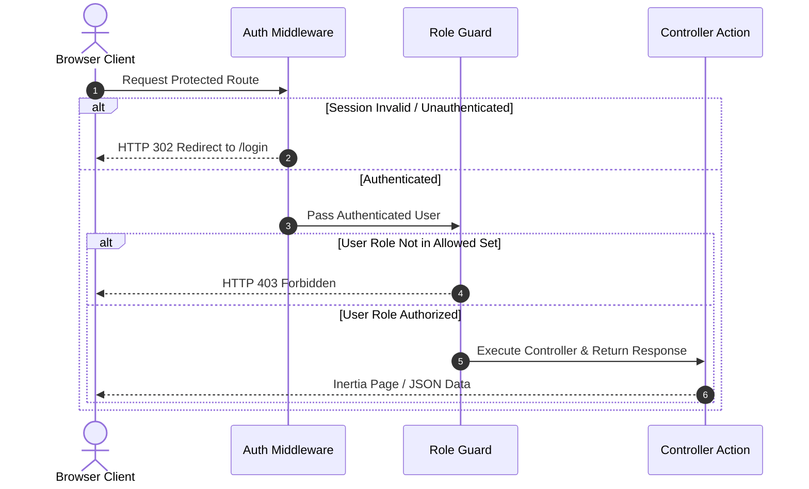

# 🛡️ Middleware, Authentication & RBAC Architecture

## 📌 Architectural Overview

Security and access control in this system are built on **Laravel 12's declarative middleware pipeline** and a strict **Three-Tier Role-Based Access Control (RBAC)** model.

The platform processes physical and financial transactions that carry regulatory, tax, and auditing consequences. Consequently, access boundaries are enforced at the network route level, preventing unauthorized role elevations before requests reach controllers.

---

## 👥 The 3 User Roles

The system recognizes three explicit roles defined in `App\Models\User`:

```
+-----------------------------------------------------------------------------------+
|                               THREE-TIER RBAC MODEL                               |
+-----------------------------------------------------------------------------------+
|  1. ADMIN   --> Full system ownership: user management, catalog, imports & config |
|  2. SALES   --> Operational trading: purchases, sales, returns, and live stock    |
|  3. AUDITOR --> Read-only compliance: views sales, purchases, COGS & analytics    |
+-----------------------------------------------------------------------------------+
```

---

## 📊 Complete Permission & Route Matrix

| Feature / Action | HTTP Method & Route | `ADMIN` | `SALES` | `AUDITOR` | Enforcing Guard |
| :--- | :--- | :---: | :---: | :---: | :--- |
| **Financial Dashboard** | `GET /dashboard` | ✅ | ✅ | ✅ | `middleware('auth')` |
| **Monthly Financial APIs** | `GET /dashboard/financials` | ✅ | ✅ | ✅ | `middleware('auth')` |
| **Top Products API** | `GET /dashboard/top-products` | ✅ | ✅ | ✅ | `middleware('auth')` |
| **COGS Report View** | `GET /cogs` | ✅ | ❌ | ✅ | `role:ADMIN,AUDITOR` |
| **COGS Dynamic API** | `GET /cogs/report` | ✅ | ❌ | ✅ | `role:ADMIN,AUDITOR` |
| **COGS CSV Export** | `GET /cogs/export-csv` | ✅ | ❌ | ✅ | `role:ADMIN,AUDITOR` |
| **View Products Catalog** | `GET /products` | ✅ | ❌ | ✅ | `role:ADMIN,AUDITOR` |
| **Create Master Product** | `POST /products` | ✅ | ❌ | ❌ | `admin` |
| **Create Product Variant**| `POST /products/variants` | ✅ | ❌ | ❌ | `admin` |
| **Update Product** | `PUT /products/{id}` | ✅ | ❌ | ❌ | `admin` |
| **Delete Product** | `DELETE /products/{id}` | ✅ | ❌ | ❌ | `admin` |
| **Bulk Import Products** | `POST /products/import` | ✅ | ❌ | ❌ | `admin` |
| **View Purchases List** | `GET /purchases` | ✅ | ✅ | ✅ | `role:ADMIN,SALES,AUDITOR` |
| **Create Purchase Order** | `POST /purchases` | ✅ | ✅ | ❌ | `role:ADMIN,SALES` |
| **Update Purchase Notes** | `PUT /purchases/{id}` | ✅ | ✅ | ❌ | `role:ADMIN,SALES` |
| **Void Purchase** | `POST /purchases/{id}/void` | ✅ | ✅ | ❌ | `role:ADMIN,SALES` |
| **Return Purchase Items** | `POST /purchases/{id}/returns`| ✅ | ✅ | ❌ | `role:ADMIN,SALES` |
| **View Sales Orders** | `GET /sales` | ✅ | ✅ | ✅ | `role:ADMIN,SALES,AUDITOR` |
| **Create Sales Order** | `POST /sales` | ✅ | ✅ | ❌ | `role:ADMIN,SALES` |
| **Update Sale Notes** | `PUT /sales/{id}` | ✅ | ✅ | ❌ | `role:ADMIN,SALES` |
| **Void Sale** | `POST /sales/{id}/void` | ✅ | ✅ | ❌ | `role:ADMIN,SALES` |
| **Return Sale Items** | `POST /sales/{id}/returns` | ✅ | ✅ | ❌ | `role:ADMIN,SALES` |
| **View Warehouses** | `GET /warehouses` | ✅ | ✅ | ✅ | `role:ADMIN,SALES,AUDITOR` |
| **Warehouse Stock API** | `GET /api/warehouses/{id}/stock`| ✅ | ✅ | ✅ | `role:ADMIN,SALES,AUDITOR` |
| **Create Warehouse** | `POST /api/warehouses` | ✅ | ❌ | ❌ | `admin` |
| **Update Warehouse** | `PUT /api/warehouses/{id}` | ✅ | ❌ | ❌ | `admin` |
| **Delete Warehouse** | `DELETE /api/warehouses/{id}` | ✅ | ❌ | ❌ | `admin` |
| **Manage Users & Roles** | `GET /users`, `POST /users`, etc.| ✅ | ❌ | ❌ | `admin` |

---

## 🔒 Middleware Pipeline (Laravel 12 Architecture)

In Laravel 12, middleware are registered declaratively in `bootstrap/app.php` rather than an `app/Http/Kernel.php` file:

```php
// bootstrap/app.php
->withMiddleware(function (Middleware $middleware) {
    $middleware->alias([
        'admin' => EnsureUserIsAdmin::class,
        'role' => EnsureUserHasRoleAccess::class,
    ]);

    $middleware->web(append: [
        HandleInertiaRequests::class,
        AddLinkHeadersForPreloadedAssets::class,
    ]);
})
```

---

## 🛠️ Middleware Deep-Dive

### 1. `App\Http\Middleware\EnsureUserIsAdmin`
- **Registered Alias:** `'admin'`
- **Purpose:** Strict gatekeeper for sensitive platform configuration, user account creation, master catalog editing, and warehouse deletions.
- **Implementation:**
  ```php
  public function handle(Request $request, Closure $next): Response
  {
      if (! $request->user() || $request->user()->role !== 'ADMIN') {
          abort(403);
      }

      return $next($request);
  }
  ```
- **Failure Mode:** Immediately aborts with HTTP status `403 Forbidden`.

---

### 2. `App\Http\Middleware\EnsureUserHasRoleAccess`
- **Registered Alias:** `'role'`
- **Purpose:** Flexible variadic role verification allowing multi-role authorizations on route groups.
- **Route Usage Examples:**
  - `Route::middleware('role:ADMIN,SALES')` -> Allows both Admins and Sales staff to execute orders.
  - `Route::middleware('role:ADMIN,AUDITOR')` -> Allows Admins and Auditors to review COGS reports and product catalogs.
  - `Route::middleware('role:ADMIN,SALES,AUDITOR')` -> Allows all authenticated roles read-only access.
- **Implementation:**
  ```php
  public function handle(Request $request, Closure $next, string ...$roles): Response
  {
      $userRole = $request->user()?->role;

      if ($userRole === null || ! in_array($userRole, $roles, true)) {
          abort(403);
      }

      return $next($request);
  }
  ```

---

### 3. `App\Http\Middleware\HandleInertiaRequests`
- **Pipeline:** Runs globally on every web request.
- **Purpose:** Injects global authentication state, active user profile, application configuration, and session flash alerts into React frontend components.
- **Shared Data Structure:**
  ```json
  {
    "auth": {
      "user": {
        "id": "UUID",
        "name": "Operator Name",
        "email": "user@company.com",
        "phone": "+251911000000",
        "role": "ADMIN",
        "is_active": true
      }
    },
    "name": "Latest-Stock",
    "quote": {
      "message": "...",
      "author": "..."
    }
  }
  ```
- This ensures React components can conditionally render action buttons (`Void`, `Return`, `Edit`) based on `auth.user.role` without making redundant API calls.

---

## 🔄 Authentication & Session Management



### Key Security Policies:
1. **Password Encryption:** Passwords are automatically hashed via bcrypt/Argon2 using Laravel's `'password' => 'hashed'` Eloquent cast in `User.php`.
2. **Account Deactivation:** The `is_active` boolean on `users` allows administrators to revoke access instantly without deleting historical records.
3. **Session Hijacking Defenses:** Session tokens are stored in the database `sessions` table, binding requests to IP addresses and client user agents.
