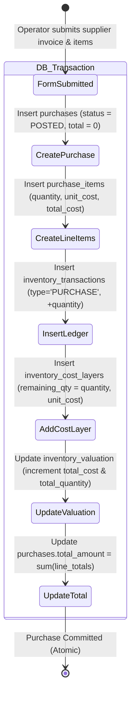

# 📥 Purchasing & Inbound Stock Workflow

## 📌 Business Overview

The **Purchasing Module** is the inbound engine of the trading platform. The company does not manufacture; all inventory originates from domestic and international suppliers.

When a purchase invoice is entered:
1. Physical goods are received into a specific warehouse.
2. The transaction ledger is credited with signed positive quantities.
3. The costing engine registers new cost layers for FIFO/LIFO and recalibrates the moving Weighted Average cost pool.

---

## 🔄 Inbound Purchase State Machine

---

## 💼 Step-by-Step Business Execution

### Step 1: Input & Validation
The operator selects a destination warehouse, specifies supplier details and invoice number, and adds one or more product variants with their received quantities and per-unit costs.

- **Request Class:** `App\Http\Requests\Order\StorePurchaseRequest`
- **Validation Rules:**
  - `warehouse_id`: Required, UUID, exists in `warehouses`.
  - `items`: Required array, minimum 1 item.
  - `items.*.variant_id`: Required, UUID, exists in `product_variants`.
  - `items.*.quantity`: Required numeric, strictly greater than zero (`gt:0`).
  - `items.*.unit_cost`: Required numeric, greater than or equal to zero (`gte:0`).

---

### Step 2: Database Transaction Boundaries
Execution is wrapped in an atomic database transaction (`DB::transaction`). If any constraint fails, the entire receipt is rolled back with zero orphaned database rows.

1. **Header Record Creation (`purchases`):**
   - `status`: Automatically set to `'POSTED'`.
   - `created_by`: ID of the authenticated user.
   - `total_amount`: Temporarily set to `0.00`.
2. **Line Items Creation (`purchase_items`):**
   - Line subtotal: `round(quantity * unit_cost, 2)`.
3. **Ledger Entry Creation (`inventory_transactions`):**
   - `transaction_type`: `'PURCHASE'`.
   - `quantity`: `+quantity` (Signed positive quantity).
   - `reference_type`: `'App\Models\Purchase'`.
   - `reference_id`: Purchase UUID.
4. **Cost Engine Ingestion (`CostingService::recordPurchase`):**
   - Instantiates a new batch in `inventory_cost_layers`.
   - Recalculates the moving average in `inventory_valuation`.
5. **Header Finalization:**
   - Sums all line subtotals and updates `purchases.total_amount`.

---

## 🔢 Concrete Numerical Walkthrough

Let us trace a real-world purchase receipt through the system:

### 📦 The Inbound Shipment:
- **Supplier:** "Gulf Extrusions LLC"
- **Invoice Number:** `INV-2026-9041`
- **Destination Warehouse:** "Main Warehouse" (`WH-MAIN`)
- **Variant:** "Profile Series 20 - Bronze, Imported" (`VAR-BRONZE-20`)
- **Received Quantity:** **100 units**
- **Direct Acquisition Cost:** **$50.00 per unit**

---

### 📊 Before vs After Database State

#### 1. `purchases` Table:
| `id` | `supplier_name` | `invoice_number` | `total_amount` | `status` |
| :--- | :--- | :--- | :---: | :---: |
| **`PURCH-01`** | Gulf Extrusions LLC | INV-2026-9041 | **$5,000.00** | **`POSTED`** |

#### 2. `purchase_items` Table:
| `id` | `purchase_id` | `variant_id` | `quantity` | `unit_cost` | `total_cost` |
| :--- | :--- | :--- | :---: | :---: | :---: |
| **`PI-01`** | PURCH-01 | VAR-BRONZE-20 | **100.0000** | **$50.0000** | **$5,000.00** |

#### 3. `inventory_transactions` Table:
| `id` | `variant_id` | `warehouse_id` | `type` | `quantity` | `unit_cost` | `reference_id` |
| :--- | :--- | :--- | :--- | :---: | :---: | :--- |
| **`IT-01`** | VAR-BRONZE-20 | WH-MAIN | **`PURCHASE`** | **+100.0000** | **$50.0000** | PURCH-01 |

#### 4. `inventory_cost_layers` Table (FIFO/LIFO):
| `id` | `variant_id` | `warehouse_id` | `remaining_qty` | `unit_cost` | `source_transaction_id` |
| :--- | :--- | :--- | :---: | :---: | :--- |
| **`LAYER-01`**| VAR-BRONZE-20 | WH-MAIN | **100.0000** | **$50.0000** | IT-01 |

#### 5. `inventory_valuation` Table (Weighted Average):
*(Assuming initial warehouse state was 0)*

| `variant_id` | `warehouse_id` | `total_quantity` | `total_cost` | `avg_unit_cost` |
| :--- | :--- | :---: | :---: | :---: |
| **`VAR-BRONZE-20`** | WH-MAIN | **100.0000** | **$5,000.0000** | **$50.0000** |

---

## 🔒 Safe Metadata Editing Rules

Once committed, purchase orders cannot have their financial quantities, units, or prices modified.

If an operator needs to update the supplier name or invoice notes:
- **Endpoint:** `PUT /purchases/{id}`
- **Service Method:** `PurchaseService::updateMetadata()`
- **Allowed Fields:** Only `supplier_name` and `notes`.
- **Blocked Fields:** `items`, `quantity`, `unit_cost`, `warehouse_id`.
- **Reasoning:** Modifying quantities directly would violate the ledger chain of custody and desynchronize physical warehouse inventory. Any quantity correction must be handled via **Void** or **Return**.
