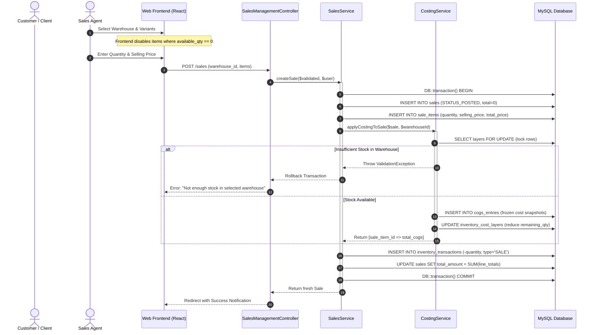

# 📤 Sales & Outbound Billing Workflow

## 📌 Business Overview

The **Sales Module** governs customer orders, revenue collection, stock dispatch, and financial Cost of Goods Sold (COGS) recognition.

In this enterprise:
- **Revenue** is recognized from `sale_items.total_price`.
- **Physical stock** is deducted via signed negative entries (`-quantity`) in `inventory_transactions`.
- **COGS** is permanently frozen into `cogs_entries` at the exact second the sale is confirmed.

---

## 🔄 Outbound Sales State Machine



---

## 🛡️ Pre-Checkout Stock Availability Verification

To prevent overselling and negative inventory:

1. **Frontend Pre-Filtering:**  
   The `SalesManagementController::index()` method pre-computes available stock across all warehouses by aggregating `remaining_qty` from `inventory_cost_layers` grouped by `warehouse_id:variant_id`. This lookup map is supplied to the React interface, disabling line items when stock is zero.

2. **Backend Concurrency Lock (`lockForUpdate`):**  
   When the order is submitted, `CostingService` queries candidate batches with `->lockForUpdate()`. If two operators attempt to sell the last 5 profiles simultaneously, the second transaction waits for the lock, observes that `availableQuantity < requestedQuantity`, and safely fails with a `ValidationException`.

---

## 🔢 Concrete Numerical Walkthrough

Let us follow an outbound customer order fulfilling from the Gulf Extrusions shipment received in Section 01.

### 📋 The Sale Order:
- **Customer:** "Modern Facades Contracting"
- **Fulfillment Warehouse:** "Main Warehouse" (`WH-MAIN`)
- **Variant:** "Profile Series 20 - Bronze, Imported" (`VAR-BRONZE-20`)
- **Quantity Sold:** **40 units**
- **Selling Price:** **$85.00 per unit**
- **Prior Stock in Warehouse:** 100 units @ $50.00 cost basis

---

### 📊 Before vs After Database State

#### 1. `sales` Table:
| `id` | `customer_name` | `total_amount` | `status` | `sale_date` |
| :--- | :--- | :---: | :---: | :---: |
| **`SALE-01`** | Modern Facades Contracting | **$3,400.00** | **`POSTED`** | 2026-04-28 |

#### 2. `sale_items` Table:
| `id` | `sale_id` | `variant_id` | `quantity` | `selling_price` | `total_price` |
| :--- | :--- | :--- | :---: | :---: | :---: |
| **`SI-01`** | SALE-01 | VAR-BRONZE-20 | **40.0000** | **$85.0000** | **$3,400.00** |

#### 3. `cogs_entries` Table (Permanent Financial Cost Snapshot):
| `id` | `sale_item_id` | `variant_id` | `quantity` | `unit_cost` | `total_cost` | `method` |
| :--- | :--- | :--- | :---: | :---: | :---: | :--- |
| **`COGS-01`** | SI-01 | VAR-BRONZE-20 | **40.0000** | **$50.0000** | **$2,000.00** | `FIFO` |

#### 4. `inventory_transactions` Table:
| `id` | `variant_id` | `warehouse_id` | `type` | `quantity` | `unit_cost` | `reference_id` |
| :--- | :--- | :--- | :--- | :---: | :---: | :--- |
| **`IT-02`** | VAR-BRONZE-20 | WH-MAIN | **`SALE`** | **-40.0000** | **$50.0000** | SALE-01 |

#### 5. `inventory_cost_layers` Table (FIFO Depletion):
| `id` | `variant_id` | `initial_qty` | `consumed_qty` | `remaining_qty` | `unit_cost` |
| :--- | :--- | :---: | :---: | :---: | :---: |
| **`LAYER-01`**| VAR-BRONZE-20 | 100.0000 | 40.0000 | **60.0000** | **$50.0000** |

#### 6. Live Physical Stock Calculation in SQL:
```sql
SELECT SUM(quantity) FROM inventory_transactions 
WHERE variant_id = 'VAR-BRONZE-20' AND warehouse_id = 'WH-MAIN';
-- Result: +100 (from IT-01) - 40 (from IT-02) = 60.0000 remaining units.
```

---

## 💰 Gross Profit Realization

From this single completed transaction, financial performance metrics are instantly realized:

$$\text{Gross Revenue} = 40 \times \$85.00 = \$3,400.00$$
$$\text{Cost of Goods Sold (COGS)} = 40 \times \$50.00 = \$2,000.00$$
$$\text{Gross Profit} = \$3,400.00 - \$2,000.00 = \mathbf{\$1,400.00}$$
$$\text{Profit Margin} = \left(\frac{\$1,400.00}{\$3,400.00}\right) \times 100 = \mathbf{41.18\%}$$
