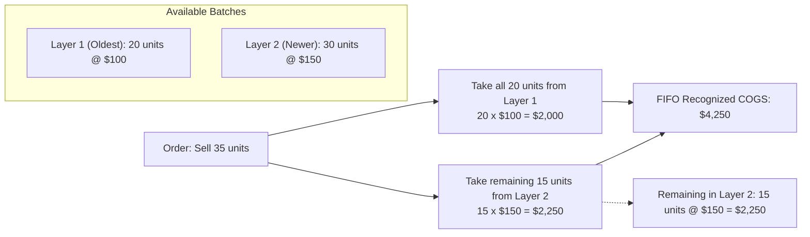
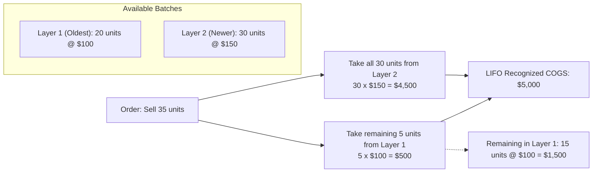

# ⚖️ Costing Engine & Valuation Methods

## 📌 Business Overview

Trading companies operate under volatile market conditions where the purchase price of aluminum profiles, coils, and extrusions fluctuates between shipments.

The system features a **Multi-Engine Costing Architecture** capable of evaluating inventory and calculating Cost of Goods Sold (COGS) under three industry-standard financial accounting methods:
1. **FIFO** (First-In, First-Out)
2. **LIFO** (Last-In, First-Out)
3. **Weighted Average** (Moving Periodic Average)

The active corporate costing method is selected centrally in `system_settings`, while auditors and executives can simulate alternative costing outcomes dynamically on the fly.

---

## 🧮 Comprehensive Comparative Simulation

To clearly understand how each costing engine impacts profit margins and balance sheet valuations, let us trace an identical transaction sequence through all three engines:

```
[Inbound Event 1] ──► Buy 20 units @ $100.00 ($2,000 total)
[Inbound Event 2] ──► Buy 30 units @ $150.00 ($4,500 total)
                      ── Total Stock: 50 units (Combined Cost: $6,500) ──

[Outbound Event 3] ─► Sell 35 units @ $200.00 ($7,000 Total Gross Revenue)
```

---

### Method A: FIFO (First-In, First-Out)

Under FIFO, the oldest inventory batches purchased are depleted first.



#### FIFO Math:
1. **Layer 1 Depletion:** Fully consumes all 20 units @ $100.00 = **$2,000.00**.
2. **Layer 2 Depletion:** Consumes 15 units (35 - 20) @ $150.00 = **$2,250.00**.
3. **Total COGS Recognized:** $\$2,000.00 + \$2,250.00 = \mathbf{\$4,250.00}$.
4. **Gross Profit Realized:** $\$7,000.00 - \$4,250.00 = \mathbf{\$2,750.00}$ (39.29% margin).
5. **Ending Inventory Value:** 15 units remaining in Layer 2 @ $150.00 = **$2,250.00**.

---

### Method B: LIFO (Last-In, First-Out)

Under LIFO, the newest inventory batches purchased are depleted first.



#### LIFO Math:
1. **Layer 2 Depletion:** Fully consumes all 30 units @ $150.00 = **$4,500.00**.
2. **Layer 1 Depletion:** Consumes 5 units (35 - 30) @ $100.00 = **$500.00**.
3. **Total COGS Recognized:** $\$4,500.00 + \$500.00 = \mathbf{\$5,000.00}$.
4. **Gross Profit Realized:** $\$7,000.00 - \$5,000.00 = \mathbf{\$2,000.00}$ (28.57% margin).
5. **Ending Inventory Value:** 15 units remaining in Layer 1 @ $100.00 = **$1,500.00**.

---

### Method C: Weighted Average

Under Weighted Average, all inventory is blended into a single perpetual moving unit cost.

#### Weighted Average Math:
1. **State Prior to Sale (in `inventory_valuation` table):**
   - $\text{Total Quantity} = 20 + 30 = 50.0000$ units.
   - $\text{Total Cost} = \$2,000.00 + \$4,500.00 = \$6,500.00$.
   - $\text{Moving Unit Cost} = \frac{\$6,500.00}{50} = \mathbf{\$130.0000}$.
2. **Sale Depletion:**
   - Sells 35 units @ $130.0000 average cost.
   - **Total COGS Recognized:** $35 \times \$130.00 = \mathbf{\$4,550.00}$.
3. **Gross Profit Realized:** $\$7,000.00 - \$4,550.00 = \mathbf{\$2,450.00}$ (35.00% margin).
4. **Ending Inventory Value:** 15 units @ $130.00 = **$1,950.00**.

---

## 📊 Side-by-Side Financial Comparison

| Accounting Metric | FIFO | LIFO | Weighted Average | Business Impact |
| :--- | :---: | :---: | :---: | :--- |
| **Gross Revenue** | $7,000.00 | $7,000.00 | $7,000.00 | Identical across all methods. |
| **COGS Recognized** | **$4,250.00** | **$5,000.00** | **$4,550.00** | FIFO yields lowest COGS during inflation. |
| **Gross Profit** | **$2,750.00** | **$2,000.00** | **$2,450.00** | FIFO yields highest reported paper profit. |
| **Profit Margin %** | **39.29%** | **28.57%** | **35.00%** | LIFO reduces taxable income in rising cost markets. |
| **Ending Inventory** | **$2,250.00** | **$1,500.00** | **$1,950.00** | FIFO shows higher asset value on balance sheet. |

---

## ⚡ Real-Time Active Reporting vs Dynamic Simulation

The system provides a unique dual reporting capability in `CostingService`:

### 1. Active Method Path (`report()`):
- When requesting reports matching the corporate standard (`system_settings.active_costing_method`):
- The query joins `sale_items` with pre-computed `cogs_entries`.
- Returns in **under 50ms**, leveraging database indexes on `cogs_entries(sale_item_id)` and `sales(sale_date)`.

### 2. Auditor Simulation Path (`dynamicReport()`):
- When an executive wants to evaluate what profits would look like under LIFO or Weighted Average without switching corporate settings:
- The service retrieves the raw chronological ledger from `inventory_transactions`.
- An in-memory state machine replays all inbound purchases and outbound sales, computing hypothetical COGS.
- **Data Safety:** The persistent database tables (`cogs_entries`, `inventory_cost_layers`) are **never modified or corrupted**.
