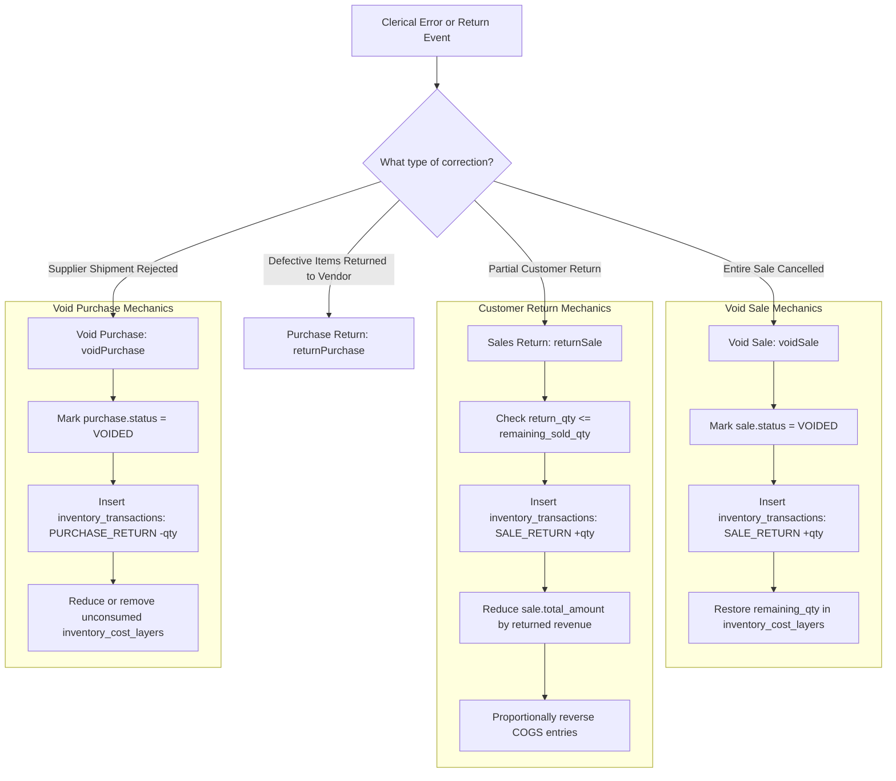

# 🛡️ Audit, Voiding & Returns Workflow

## 📌 Business Overview

In industrial trading, mistakes and changes are inevitable:
- A salesperson might bill the wrong customer name or invoice number.
- A client might cancel an order prior to delivery.
- A customer might return 5 defective profiles out of a 50-unit order.
- A container of imported aluminum may be rejected and sent back to the supplier.

To comply with accounting and corporate audit standards, **hard deletion (`DELETE FROM`) is strictly prohibited**. All corrections are processed via non-destructive reversals and returns implemented in `App\Services\CorrectionService`.

---

## 🔄 Reversal & Return Architecture

---

## 1. 🚫 Workflow A: Voiding a Sale (`voidSale`)

### When to Use:
An order was posted in error (e.g. wrong client, duplicate entry) and the entire transaction must be cancelled.

### Step-by-Step Execution:
1. **Concurrency Lock:** Queries the target `sales` record with eager-loaded `items.cogsEntries` using `->lockForUpdate()`.
2. **Pre-condition Validation:** Verifies that `status !== VOIDED` and that original sale inventory transactions exist.
3. **Inventory Reversal:**
   - Queries the original `inventory_transactions` associated with this sale.
   - For every line, inserts a new `inventory_transactions` row with `transaction_type = 'SALE_RETURN'` and **positive quantity** (`+abs(original_quantity)`).
   - `reference_type` is set to `'VOID'`.
4. **COGS Reversal:**
   - For FIFO/LIFO: Re-credits the consumed units back to their original `inventory_cost_layers` batches.
   - For Weighted Average: Re-credits total quantity and monetary cost back to `inventory_valuation`.
5. **Header Update:**
   - Updates `sales.status = 'VOIDED'`.
   - Sets `reference_type = 'VOID'`.
   - Appends the audit justification note.

---

## 2. ↩️ Workflow B: Processing a Partial Customer Return (`returnSale`)

### When to Use:
A customer keeps most of an order but returns a portion (e.g., 5 profiles out of 40) due to site plan changes or minor surface scratches.

### 🔢 Concrete Numerical Walkthrough

Recall the earlier sale:
- **Sale Order:** `SALE-01`
- **Sold Quantity:** 40 units @ $85.00 = $3,400.00
- **Recognized COGS:** 40 units @ $50.00 = $2,000.00

The customer returns **5 units**:

#### 1. Remaining Sold Validation:
$$\text{Max Allowed Return} = \text{Sold Quantity} (40) - \text{Already Returned} (0) = 40$$
Since $5 \le 40$, the return is permitted.

#### 2. Revenue Deduction:
$$\text{Return Revenue Delta} = 5 \times \$85.00 = \$425.00$$
$$\text{Updated Sale Total Amount} = \$3,400.00 - \$425.00 = \mathbf{\$2,975.00}$$

#### 3. COGS & Stock Restorations:
- **Inventory Ledger:** Inserts `inventory_transactions` record:
  - `transaction_type`: `'SALE_RETURN'`
  - `quantity`: **`+5.0000`** (5 units physically returned to Main Warehouse)
  - `reference_type`: `'RETURN'`
  - `reference_id`: `SALE-01`
- **Cost Layer Restoration:**
  - Adds 5 units back to the layer: `LAYER-01.remaining_qty` increases from **60.0000** to **65.0000**.
- **Financial COGS Adjustment:**
  - COGS for this sale is adjusted down by $5 \times \$50.00 = \$250.00$ (from $2,000.00 to $1,750.00).

---

## 3. 🚫 Workflow C: Voiding a Purchase (`voidPurchase`)

### When to Use:
A supplier bill was recorded under the wrong company entity or rejected upon delivery.

### Execution Steps:
1. **Lock & Verify:** Locks `purchases` record and validates that `status !== VOIDED`.
2. **Reverse Inventory Ledger:**
   - Inserts `inventory_transactions` row with `transaction_type = 'PURCHASE_RETURN'`.
   - Quantity is **signed negative** (`-abs(quantity)`) to pull the goods back out of the warehouse.
3. **Deplete Cost Batches:**
   - Removes or decrements the corresponding unconsumed layer in `inventory_cost_layers`.
4. **Header Invalidation:**
   - Marks `purchases.status = 'VOIDED'`.

---

## 4. ↩️ Workflow D: Partial Purchase Return to Vendor (`returnPurchase`)

### When to Use:
10 units in an incoming 100-unit batch of imported profiles arrive dented and are immediately shipped back to the manufacturer for a supplier credit memo.

### Execution Steps:
1. Validates that returned quantity does not exceed unreturned received quantities.
2. Deducts the 10 units from the batch's `remaining_qty` in `inventory_cost_layers`.
3. Inserts an outbound `PURCHASE_RETURN` row into `inventory_transactions` (`quantity = -10.0000`).
4. Updates parent purchase notes with vendor RMA/Credit Memo tracking numbers.

---

## 📋 Summary of Reversal Ledger Signage

| Operation | Service Method | Target Table | Ledger `transaction_type` | Quantity Sign | Physical Effect |
| :--- | :--- | :--- | :--- | :---: | :--- |
| **Void Sale** | `voidSale` | `sales` | `SALE_RETURN` | **`+` (Positive)** | Stock returned to warehouse. |
| **Sales Return** | `returnSale` | `sales` | `SALE_RETURN` | **`+` (Positive)** | Partial stock returned to warehouse. |
| **Void Purchase** | `voidPurchase` | `purchases` | `PURCHASE_RETURN` | **`-` (Negative)** | Stock removed from warehouse. |
| **Purchase Return** | `returnPurchase`| `purchases` | `PURCHASE_RETURN` | **`-` (Negative)** | Defective stock returned to vendor. |
