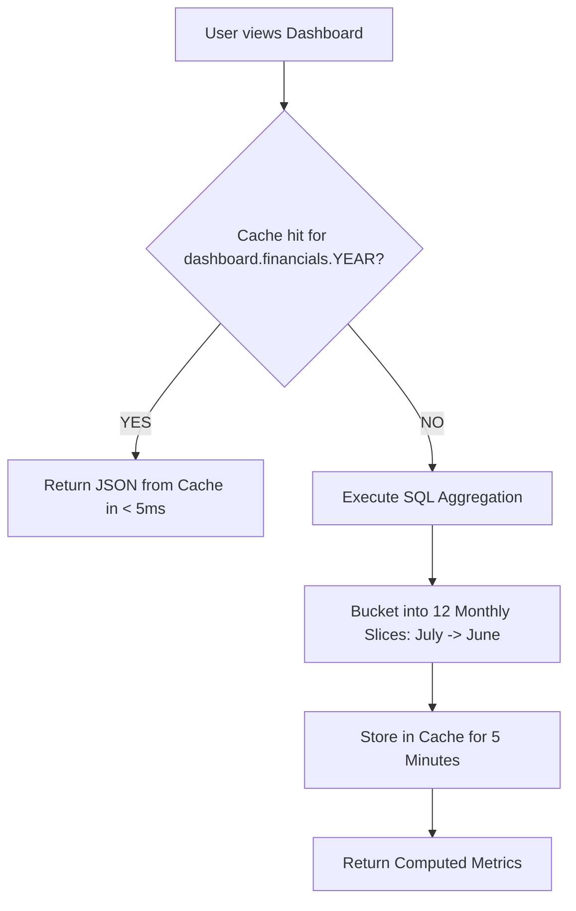

# 📊 Executive Analytics & Financial Reporting

## 📌 Business Overview

The **Executive Analytics Engine** transforms thousands of granular inventory movements and line-item transactions into high-level business intelligence.

Operating executives, CFOs, and auditors use these metrics to answer four critical commercial questions:
1. **How much revenue did the company generate this fiscal year?**
2. **What was the true acquisition cost (COGS) of the inventory sold?**
3. **What is the company's real gross profit margin?**
4. **Which specific aluminum profiles and finishes drive commercial volume?**

---

## 📈 Core Financial KPI Formulas

All metrics are calculated exclusively from `POSTED` transactions (voided orders are filtered out):

```
+-----------------------------------------------------------------------------------------+
|                               FINANCIAL KPI EQUATIONS                                   |
+-----------------------------------------------------------------------------------------+
|  1. GROSS REVENUE  = SUM(sale_items.total_price) WHERE sales.status = 'POSTED'          |
|  2. TOTAL COGS     = SUM(cogs_entries.total_cost) WHERE sales.status = 'POSTED'         |
|  3. GROSS PROFIT   = GROSS REVENUE - TOTAL COGS                                         |
|  4. PROFIT MARGIN  = (GROSS PROFIT / GROSS REVENUE) * 100                               |
+-----------------------------------------------------------------------------------------+
```

---

## 📅 The Corporate Fiscal Year Definition

Trading organizations rarely align their accounting periods with the standard January–December calendar year. In this system, the fiscal year operates from **July 1st to June 30th**:

$$\text{Fiscal Year } Y = \text{July 1, } Y \implies \text{June 30, } (Y + 1)$$

### Resolution Algorithm:
Implemented in `App\Http\Controllers\DashboardController`:
```php
private function currentFiscalYear(): int
{
    $today = now();
    return $today->month >= 7 ? $today->year : $today->year - 1;
}
```
*Example:* On October 14, 2026, the current fiscal year is **2026** (spanning July 1, 2026 to June 30, 2027). On March 15, 2026, the fiscal year was **2025** (July 1, 2025 to June 30, 2026).

---

## ⚡ High-Performance 5-Minute Caching Layer

Because fiscal reports require aggregating thousands of rows across `sales`, `sale_items`, and `cogs_entries`, re-running raw SQL queries on every dashboard page view would degrade database throughput.

The system uses a **5-minute cached aggregation pipeline**:



### Cached Payload Structure:
```json
{
  "fiscal_year": 2026,
  "start_date": "2026-07-01",
  "end_date": "2027-06-30",
  "totals": {
    "revenue": 1450000.00,
    "cogs": 980000.00,
    "gross_profit": 470000.00
  },
  "months": [
    { "month": "2026-07", "label": "Jul 2026", "revenue": 120000.00, "cogs": 80000.00, "gross_profit": 40000.00 },
    { "month": "2026-08", "label": "Aug 2026", "revenue": 135000.00, "cogs": 91000.00, "gross_profit": 44000.00 },
    { "month": "2026-09", "label": "Sep 2026", "revenue": 110000.00, "cogs": 75000.00, "gross_profit": 35000.00 }
  ]
}
```

---

## 🏆 Top Products Ranking Algorithm

To identify sales volume drivers, the `/dashboard/top-products` endpoint computes the top-selling items:

### Query Pipeline:
1. Joins `sale_items`, `sales`, `product_variants`, and `products`.
2. Restricts to `sales.status = 'POSTED'` within the target fiscal year.
3. Groups by `pv.id`, `p.name`, `pv.color`, and `pv.origin`.
4. Orders descending by `SUM(si.quantity)`.
5. Formats a clear commercial display label: `Product Name - Color - Origin` (e.g., `"Aluminum Profile Series 20 - Bronze - Imported"`).
6. Caches the result under `dashboard.top-products.{year}.{limit}` for 5 minutes.

---

## 📥 Real-Time Paginated Reporting vs CSV Streaming

For deep compliance audits, the COGS module provides two delivery mechanisms:

### 1. Interactive Web Pagination (`GET /cogs/report`):
- Paginates 10 to 100 rows per page.
- Returns columns: `product_name`, `color`, `origin`, `quantity_sold`, `revenue`, `cogs`, `gross_profit`, `profit_margin`.
- Supports on-the-fly method switching (evaluating FIFO vs LIFO vs Weighted Average).

### 2. High-Capacity CSV Streaming (`GET /cogs/export-csv`):
- Uses Symfony's `StreamedResponse` and PHP's `fputcsv()`.
- Flushes data row-by-row directly into the HTTP response stream without building large arrays in server RAM.
- Capable of exporting multi-year transaction ledgers without memory-exhaustion crashes.
