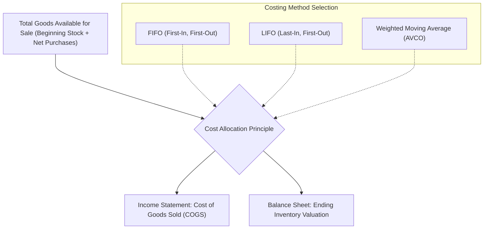

# 📐 Comprehensive Guide to Inventory Valuation: FIFO, LIFO & Weighted Average

---

## 📌 Executive Summary & The Inventory Valuation Dilemma

In wholesale and industrial trading enterprises—such as aluminum distribution—purchase prices for raw commodities and manufactured extrusions fluctuate constantly due to global smelting costs, currency exchange rates, freight charges, and market tariffs. 

When identical units of an inventory item (e.g., *Aluminum Rectangular Tube 50x25mm, Matte Black*) are acquired across multiple shipments at varying unit costs, a fundamental accounting question arises upon making a sale:

> **"When 100 units are sold from a warehouse containing units purchased at \$50, \$55, and \$60, which specific cost should be deducted from revenue to calculate Cost of Goods Sold (COGS) and tax liabilities?"**



### The Fundamental Inventory Accounting Equation
Regardless of the valuation method chosen, the conservation of value always holds true:

$$\text{Goods Available for Sale} = \text{Beginning Inventory Value} + \text{Total Purchases Cost}$$
$$\text{Goods Available for Sale} = \text{Cost of Goods Sold (COGS)} + \text{Ending Inventory Value}$$

The choice of costing method simply determines **how the total dollar value is partitioned between COGS (expensed on the Income Statement) and Ending Inventory (capitalized as an asset on the Balance Sheet)**.

### The Immutable Golden Rule of This System
In this platform, **COGS is calculated and frozen into `cogs_entries` at the exact instant a sale is executed**. The system **never retroactively recalculates past recorded COGS**. If an auditor evaluates alternative methods, the system runs an **in-memory simulation replay**, preserving the historical audit trail.

---

## 🥇 1. Method 1: First-In, First-Out (FIFO)

### 1.1 Core Concept & Theory
The **First-In, First-Out (FIFO)** method assumes that the oldest inventory items purchased are the first ones sold. 

* **Physical Analogy:** A conveyor belt or milk shelf where older stock is consumed before newer shipments.
* **Accounting Standards:** Fully approved and endorsed under **IFRS** (IAS 2) and **US GAAP**.

### 1.2 Mathematical Formulation & Algorithmic Mechanics
Let an inventory item have $k$ chronological inbound purchase layers:
$$L_1, L_2, \dots, L_k \quad \text{where } \text{Timestamp}(L_1) < \text{Timestamp}(L_2) < \dots < \text{Timestamp}(L_k)$$

Each layer $i$ possesses an available quantity $Q_i$ and a landed unit cost $C_i$.

When a sale requires quantity $S_{\text{req}}$, the engine consumes layers in ascending chronological order ($i = 1, 2, \dots$):
$$\text{For each layer } i: \quad q_i = \min(Q_i, S_{\text{remaining}})$$
$$\text{COGS}_{\text{FIFO}} = \sum_{i=1}^{m} (q_i \times C_i)$$
$$S_{\text{remaining}} \leftarrow S_{\text{remaining}} - q_i$$

### 1.3 Database Architecture in the Application
FIFO relies on the `inventory_cost_layers` table:

```sql
SELECT id, remaining_quantity, unit_cost
FROM inventory_cost_layers
WHERE variant_id = :variant_id
  AND warehouse_id = :warehouse_id
  AND remaining_quantity > 0
ORDER BY created_at ASC, id ASC;
```

As quantities are depleted, the engine executes an atomic `UPDATE` reducing `remaining_quantity`. For each depleted layer, a distinct row is written to `cogs_entries` recording `cost_layer_id`, `quantity`, `unit_cost`, and `total_cost`.

### 1.4 Numerical Example (FIFO)

**Inbound Batches:**
* **Batch A (May 01):** Purchase 100 units @ **\$50.00** = \$5,000.00
* **Batch B (May 10):** Purchase 150 units @ **\$60.00** = \$9,000.00
* *Total Goods Available:* 250 units, Total Cost = \$14,000.00

**Outbound Sale (May 15):** Customer purchases **180 units** @ \$90.00 retail.

**FIFO Depletion Calculation:**
1. Layer A (oldest) has 100 units $\implies$ Fully consume 100 units @ \$50.00 = **\$5,000.00**.
2. Remaining units needed = $180 - 100 = 80$ units.
3. Layer B has 150 units $\implies$ Consume 80 units @ \$60.00 = **\$4,800.00**.
4. Remaining in Layer B = $150 - 80 = 70$ units @ \$60.00.

$$\mathbf{\text{COGS}_{\text{FIFO}}} = \$5,000.00 + \$4,800.00 = \mathbf{\$9,800.00}$$
$$\mathbf{\text{Ending Inventory Value}} = 70 \times \$60.00 = \mathbf{\$4,200.00}$$
$$\mathbf{\text{Gross Profit}} = (180 \times \$90.00) - \$9,800.00 = \$16,200.00 - \$9,800.00 = \mathbf{\$6,400.00}$$

### 1.5 Economic Characteristics
* **In Inflationary Environments (Prices Rising):** Older, cheaper costs are expensed $\implies$ **Lowest COGS**, **Highest Reported Gross Profit**, **Highest Balance Sheet Inventory Valuation** (reflecting modern replacement costs).
* **Tax Impact:** Higher taxable profit in periods of inflation.

---

## 🥈 2. Method 2: Last-In, First-Out (LIFO)

### 2.1 Core Concept & Theory
The **Last-In, First-Out (LIFO)** method assumes that the most recently purchased inventory items are the first ones sold.

* **Physical Analogy:** A stack of bricks or coal pile where newly arrived items are deposited on top and removed first.
* **Accounting Standards:** Permitted under **US GAAP**, but strictly **prohibited under IFRS** (due to artificial depression of tax liabilities and distortion of ending inventory). The system provides full LIFO support for compliance with jurisdictions and enterprise simulation.

### 2.2 Mathematical Formulation & Algorithmic Mechanics
Using the same set of chronological inbound layers $L_1, \dots, L_k$, LIFO consumes layers in **descending chronological order** ($i = k, k-1, \dots$):
$$\text{For each layer } i \text{ from newest to oldest}: \quad q_i = \min(Q_i, S_{\text{remaining}})$$
$$\text{COGS}_{\text{LIFO}} = \sum_{i=k}^{1} (q_i \times C_i)$$

### 2.3 Database Architecture in the Application
LIFO uses the exact same `inventory_cost_layers` table as FIFO, but modifies the consumption query sorting order:

```sql
SELECT id, remaining_quantity, unit_cost
FROM inventory_cost_layers
WHERE variant_id = :variant_id
  AND warehouse_id = :warehouse_id
  AND remaining_quantity > 0
ORDER BY created_at DESC, id DESC;
```

### 2.4 Numerical Example (LIFO)

Using the exact same inventory profile:
* **Batch A (May 01):** 100 units @ **\$50.00**
* **Batch B (May 10):** 150 units @ **\$60.00**
* *Total Goods Available:* 250 units, Total Cost = \$14,000.00

**Outbound Sale (May 15):** Customer purchases **180 units** @ \$90.00 retail.

**LIFO Depletion Calculation:**
1. Layer B (newest) has 150 units $\implies$ Fully consume 150 units @ \$60.00 = **\$9,000.00**.
2. Remaining units needed = $180 - 150 = 30$ units.
3. Layer A has 100 units $\implies$ Consume 30 units @ \$50.00 = **\$1,500.00**.
4. Remaining in Layer A = $100 - 30 = 70$ units @ \$50.00.

$$\mathbf{\text{COGS}_{\text{LIFO}}} = \$9,000.00 + \$1,500.00 = \mathbf{\$10,500.00}$$
$$\mathbf{\text{Ending Inventory Value}} = 70 \times \$50.00 = \mathbf{\$3,500.00}$$
$$\mathbf{\text{Gross Profit}} = \$16,200.00 - \$10,500.00 = \mathbf{\$5,700.00}$$

### 2.5 Economic Characteristics
* **In Inflationary Environments (Prices Rising):** Recent, higher costs are expensed $\implies$ **Highest COGS**, **Lowest Reported Gross Profit**, **Lowest Balance Sheet Inventory Valuation** (assets are valued at stale, historical prices).
* **Tax Impact:** Minimizes tax liability by matching current high costs against current revenue.

---

## 🥉 3. Method 3: Weighted Moving Average (AVCO / Perpetual Average)

### 3.1 Core Concept & Theory
The **Weighted Moving Average** (or Perpetual Moving Average) method pools all units into an indistinguishable single cost pool. Whenever new inventory is purchased, a **new average unit cost** is recalculated. Every sale consumes stock at the currently prevailing weighted average cost.

* **Physical Analogy:** A liquid fuel tank or grain silo where new deliveries mix continuously with existing stock.
* **Accounting Standards:** Fully approved and endorsed under both **IFRS** and **US GAAP**. Highly favored for volatile commodity markets (such as aluminum).

### 3.2 Mathematical Formulation & Algorithmic Mechanics
The system recalculates the moving average **only upon new inbound purchases**:

$$\text{New Average Unit Cost} = \frac{(\text{Existing Quantity} \times \text{Existing Avg Cost}) + (\text{Inbound Quantity} \times \text{Inbound Unit Cost})}{\text{Existing Quantity} + \text{Inbound Quantity}}$$

$$\overline{C}_{\text{new}} = \frac{V_{\text{current}} + (\Delta Q \times C_{\text{in}})}{Q_{\text{current}} + \Delta Q}$$

**Outbound Sales Rule:**
A sale does **NOT** alter the average unit cost. It simply reduces the total pool quantity and total capitalized cost:
$$\text{COGS}_{\text{AVCO}} = S_{\text{req}} \times \overline{C}_{\text{current}}$$
$$Q_{\text{new}} = Q_{\text{current}} - S_{\text{req}}$$
$$V_{\text{new}} = Q_{\text{new}} \times \overline{C}_{\text{current}}$$

### 3.3 Database Architecture in the Application
Weighted Average does not require layer tracking; it is maintained in the `inventory_valuation` table:

| Field | Type | Description |
| :--- | :--- | :--- |
| `variant_id` | `CHAR(36)` | Product Variant foreign key |
| `warehouse_id` | `CHAR(36)` | Physical warehouse foreign key |
| `total_quantity` | `DECIMAL(15, 4)` | Current accumulated stock quantity |
| `total_cost` | `DECIMAL(15, 2)` | Total monetary capitalization |
| `avg_unit_cost` | `DECIMAL(15, 4)` | Continuously updated unit cost |

### 3.4 Numerical Example (Weighted Average)

Using the exact same inventory profile:

**Step 1: May 01 — Batch A Arrives (100 units @ \$50.00)**
* Existing Pool: 0 units, \$0.00
* Inbound: 100 units, \$5,000.00
* Pool State: Quantity = 100, Total Cost = \$5,000.00, **Average Cost = \$50.0000**

**Step 2: May 10 — Batch B Arrives (150 units @ \$60.00)**
* Inbound Cost: $150 \times \$60.00 = \$9,000.00$
* New Total Quantity: $100 + 150 = 250$ units
* New Total Cost: $\$5,000.00 + \$9,000.00 = \$14,000.00$
* Recalculated Average Unit Cost:
  $$\overline{C} = \frac{\$14,000.00}{250} = \mathbf{\$56.0000}$$

**Step 3: May 15 — Outbound Sale of 180 units @ \$90.00**
* The current average cost is \$56.0000.
$$\mathbf{\text{COGS}_{\text{AVCO}}} = 180 \times \$56.0000 = \mathbf{\$10,080.00}$$
$$\mathbf{\text{Ending Inventory Value}} = (250 - 180) \times \$56.0000 = 70 \times \$56.0000 = \mathbf{\$3,920.00}$$
$$\mathbf{\text{Gross Profit}} = \$16,200.00 - \$10,080.00 = \mathbf{\$6,120.00}$$

### 3.5 Economic Characteristics
* **Smooths Market Volatility:** Eliminates severe spikes or dips caused by individual purchase batches.
* **Balanced Financials:** COGS, Gross Profit, and Ending Inventory consistently sit **directly between FIFO and LIFO**.

---

## 🥊 4. Head-to-Head Comparative Master Scenario

To demonstrate how the three methods diverge in an active enterprise, consider an identical sequence of 5 transactions over one week for SKU: `ALU-TUBE-50-BLK`:

### Transaction History

| Day | Event | Quantity | Unit Price / Cost | Total Amount | Running Physical Stock |
| :--- | :--- | :---: | :---: | :---: | :---: |
| **Mon** | **Purchase 1** | +100 | \$100.00 (Cost) | \$10,000.00 | 100 pcs |
| **Tue** | **Purchase 2** | +200 | \$120.00 (Cost) | \$24,000.00 | 300 pcs |
| **Wed** | **Sale 1** | -150 | \$180.00 (Retail) | \$27,000.00 | 150 pcs |
| **Thu** | **Purchase 3** | +150 | \$140.00 (Cost) | \$21,000.00 | 300 pcs |
| **Fri** | **Sale 2** | -200 | \$190.00 (Retail) | \$38,000.00 | 100 pcs |

* **Total Revenue:** $\$27,000.00 + \$38,000.00 = \mathbf{\$65,000.00}$ (identical across all methods)
* **Total Inbound Purchases:** $100 + 200 + 150 = \mathbf{450\text{ units}}$, Total Cost = $\mathbf{\$55,000.00}$
* **Total Units Sold:** $150 + 200 = \mathbf{350\text{ units}}$
* **Ending Physical Stock:** $450 - 350 = \mathbf{100\text{ units}}$

---

### Step-by-Step Execution Comparison

#### Step 1: Sale 1 (150 units on Wednesday)
Prior stock: 100 @ \$100, 200 @ \$120. (Total: 300 units @ \$34,000, Avg = \$113.3333)

* **FIFO:** Consumes 100 @ \$100 (\$10,000) + 50 @ \$120 (\$6,000) = **\$16,000.00 COGS**.  
  *Remaining:* 150 @ \$120.
* **LIFO:** Consumes 150 @ \$120 (\$18,000) = **\$18,000.00 COGS**.  
  *Remaining:* 100 @ \$100, 50 @ \$120.
* **AVCO:** Consumes 150 @ \$113.3333 = **\$17,000.00 COGS**.  
  *Remaining:* 150 units @ \$113.3333 (\$17,000.00 total).

#### Step 2: Purchase 3 (150 units @ \$140 on Thursday)
* **FIFO Layers:** Layer 2 (150 @ \$120) + Layer 3 (150 @ \$140).
* **LIFO Layers:** Layer 1 (100 @ \$100) + Layer 2 (50 @ \$120) + Layer 3 (150 @ \$140).
* **AVCO Pool:** Existing (\$17,000) + Inbound (\$21,000) = \$38,000 / 300 units $\implies$ **New Avg = \$126.6667**.

#### Step 3: Sale 2 (200 units on Friday)
* **FIFO:** Consumes 150 @ \$120 (\$18,000) + 50 @ \$140 (\$7,000) = **\$25,000.00 COGS**.  
  *Ending Inventory:* 100 units @ \$140 = **\$14,000.00**.
* **LIFO:** Consumes 150 @ \$140 (\$21,000) + 50 @ \$120 (\$6,000) = **\$27,000.00 COGS**.  
  *Ending Inventory:* 100 units @ \$100 = **\$10,000.00**.
* **AVCO:** Consumes 200 @ \$126.6667 = **\$25,333.33 COGS**.  
  *Ending Inventory:* 100 units @ \$126.6667 = **\$12,666.67**.

---

### Grand Financial Scorecard

| Financial Metric | FIFO | Weighted Average | LIFO | Mathematical Verification |
| :--- | :---: | :---: | :---: | :--- |
| **Gross Revenue** | \$65,000.00 | \$65,000.00 | \$65,000.00 | Identical for all methods |
| **Sale 1 COGS** | \$16,000.00 | \$17,000.00 | \$18,000.00 | LIFO expenses highest initial cost |
| **Sale 2 COGS** | \$25,000.00 | \$25,333.33 | \$27,000.00 | LIFO captures recent \$140 purchase |
| **Total Cumulative COGS** | **\$41,000.00** | **\$42,333.33** | **\$45,000.00** | $\Delta = \$4,000.00$ spread |
| **Gross Profit** | **\$24,000.00** | **\$22,666.67** | **\$20,000.00** | FIFO yields +\$4,000 profit |
| **Gross Margin %** | **36.92%** | **34.87%** | **30.77%** | FIFO shows highest profitability |
| **Ending Inventory Value (100 pcs)** | **\$14,000.00** | **\$12,666.67** | **\$10,000.00** | LIFO undervalues asset by \$4,000 |
| **COGS + Ending Inventory** | **\$55,000.00** | **\$55,000.00** | **\$55,000.00** | **Exactly equals Total Purchases (\$55,000)!** |

---

## 💻 5. Implementation Code Architecture

The costing logic is centrally implemented in `app/Services/CostingService.php`.

### 5.1 FIFO & LIFO Layer Consumption Logic
```php
public function consumeLayers(
    string $variantId,
    string $warehouseId,
    float $quantityRequired,
    string $method // 'FIFO' or 'LIFO'
): array {
    $sortDirection = ($method === 'LIFO') ? 'desc' : 'asc';

    $layers = InventoryCostLayer::where('variant_id', $variantId)
        ->where('warehouse_id', $warehouseId)
        ->where('remaining_quantity', '>', 0)
        ->orderBy('created_at', $sortDirection)
        ->orderBy('id', $sortDirection)
        ->lockForUpdate()
        ->get();

    $consumed = [];
    $remainingNeeded = $quantityRequired;

    foreach ($layers as $layer) {
        if ($remainingNeeded <= 0) break;

        $take = min((float) $layer->remaining_quantity, $remainingNeeded);
        $layer->remaining_quantity = bcsub($layer->remaining_quantity, (string)$take, 4);
        $layer->save();

        $consumed[] = [
            'layer_id'   => $layer->id,
            'quantity'   => $take,
            'unit_cost'  => (float) $layer->unit_cost,
            'total_cost' => bcmul((string)$take, (string)$layer->unit_cost, 4),
        ];

        $remainingNeeded = bcsub((string)$remainingNeeded, (string)$take, 4);
    }

    if ($remainingNeeded > 0) {
        throw new InsufficientCostLayerException("Cost layers exhausted for variant {$variantId}");
    }

    return $consumed;
}
```

### 5.2 Weighted Average Moving Pool Calculation
```php
public function recordInboundPurchase(
    string $variantId,
    string $warehouseId,
    float $inboundQty,
    float $inboundUnitCost
): void {
    $valuation = InventoryValuation::firstOrCreate(
        ['variant_id' => $variantId, 'warehouse_id' => $warehouseId],
        ['total_quantity' => 0, 'total_cost' => 0, 'avg_unit_cost' => 0]
    );

    $currentQty  = (float) $valuation->total_quantity;
    $currentCost = (float) $valuation->total_cost;
    $inboundCost = $inboundQty * $inboundUnitCost;

    $newQty  = $currentQty + $inboundQty;
    $newCost = $currentCost + $inboundCost;
    $newAvg  = ($newQty > 0) ? ($newCost / $newQty) : 0.0000;

    $valuation->update([
        'total_quantity' => $newQty,
        'total_cost'     => round($newCost, 2),
        'avg_unit_cost'  => round($newAvg, 4),
    ]);
}
```

---

## 🔄 6. Handling Edge Cases, Returns & Reversals

### 6.1 Customer Returns (`SALE_RETURN`)
When a customer returns sold goods:
* **Weighted Average:** The returning quantity is added back to `total_quantity`, and its cost value is restored to `total_cost`.
* **FIFO / LIFO:** The original layer consumed during the sale is located via `cogs_entries.cost_layer_id`, and `remaining_quantity` is restored by the returned amount. If the original layer has expired or cannot be restored, a compensating return layer is created at the original purchase cost.

### 6.2 Order Voiding Safeguards
* **Sale Voiding:** Automatically executes a full return, setting the sale status to `VOIDED`, reversing the COGS entries, and restoring the stock layers.
* **Purchase Voiding:** A purchase can only be voided if its inventory layers have **not yet been consumed by subsequent sales**. If partial layers have been sold, the system blocks the void operation with HTTP 422: *"Cannot void purchase: inventory has already been fulfilled to outbound sales. Initiate a vendor return instead."*

---

## 🎯 7. Method Selection Decision Matrix for Management

| Business Objective | Recommended Method | Rationale |
| :--- | :---: | :--- |
| **Strict IFRS / International Compliance** | **FIFO** or **Weighted Average** | LIFO is strictly illegal under IFRS IAS 2. |
| **Volatile Commodity Trading (Aluminum)** | **Weighted Average** | Dampens price spikes caused by international freight fluctuations; prevents drastic margin swings. |
| **Maximizing Reported Earnings & Valuation** | **FIFO** (in inflation) | Capitalizes current high costs into ending inventory; minimizes current COGS. |
| **Minimizing Current Tax Liabilities** | **LIFO** (US GAAP only) | Matches current high replacement costs against revenues, reducing taxable gross profit. |
| **Simplicity of Multi-Warehouse Auditing** | **Weighted Average** | Maintains a clean single-row valuation record per warehouse without thousands of micro-layers. |
